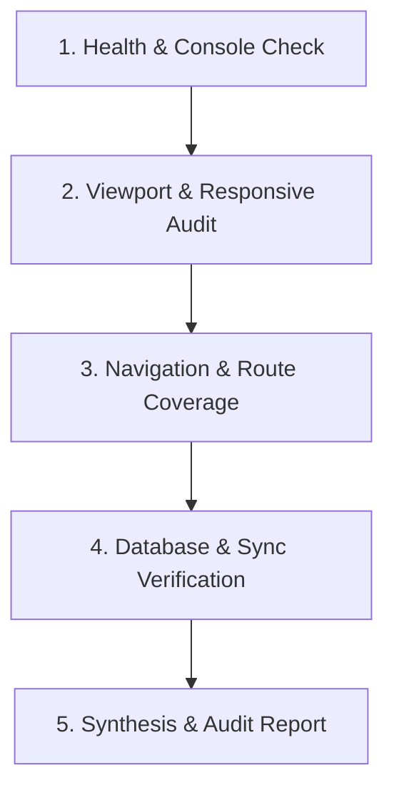

# Web Automation & Testing (E2E & System Integrity)

A specialized skill for automating web interactions, auditing UI/UX quality, and rigorously testing data/database synchronization layers across web applications.

## When to Activate
- Conducting full-system automated regression tests.
- Auditing UI/UX for responsiveness, usability issues, layout shifts, or perceived performance flaws.
- Testing client-side databases (IndexedDB, Dexie, LocalStorage) and cloud backend synchronization (Supabase, PostgreSQL).
- Verifying authentication flows, session continuity, security wipes, and real-time event propagation.
- Checking console errors, unhandled rejections, and network payload efficiency (Egress/Ingress).

---

## 1. Automated Testing Architecture & Tools

### 1.1 In-Session Browser Automation (Chrome DevTools MCP)
Use the live Chrome DevTools integration for automated real-browser testing:
- **Navigation & Lifecycle**: `navigate_page`, `select_page`, `list_pages`
- **User Actions**: `click`, `type_text`, `fill`, `fill_form`, `hover`, `press_key`
- **DOM & Visual Inspection**: `evaluate_script`, `take_screenshot`, `get_css_styles`
- **Network & Diagnostics**: `list_console_messages`, `list_network_requests`, `lighthouse_audit`
- **Responsive Emulation**: `resize_page`, `emulate` (mobile/tablet viewports)

### 1.2 Programmatic Test Scripts
When running reproducible batch tests, use lightweight Node.js/Vite automation scripts executed via `run_command` to test database schemas, Dexie operations, and Supabase RPC endpoints.

---

## 2. UI/UX Heuristic Audit Standards

Always audit interfaces against these professional design and usability benchmarks:

### 2.1 Perceived Performance & Visual Continuity
- **Zero White Blank Freezes**: When data is loading, the UI must immediately render modern skeleton placeholders or progress spinners, never an empty white container.
- **Instant Optimistic / Cached Feedback**: Data cached locally must display in 0ms before background cloud sync resolves.
- **Empty States**: If a dataset contains 0 items, display an informative Empty State with an icon, descriptive explanation, and a direct Call-To-Action (CTA) button, never an empty blank void.

### 2.2 Responsive Layouts & Touch Targets
- **Mobile (< 768px)**:
  - Minimum touch target: `44x44px` for buttons, icons, and interactive elements.
  - No horizontal overflow / horizontal scrollbar leaks on the document body.
  - Bottom navigation bar or sticky actions must support iOS safe area insets (`env(safe-area-inset-bottom)`).
  - Cards and lists should stack gracefully with adequate padding (12px - 16px).
- **Tablet (768px - 1024px)**:
  - Collapsible sidebars, flexible grid columns (2 to 3 cards per row).
- **Desktop (> 1024px)**:
  - Tables must have horizontal scroll containment with visible column headers and sticky headers where applicable.

### 2.3 Strict UI Policy
- **Banned Native Dialogs**: Prohibit `window.alert()`, `window.confirm()`, `window.prompt()`. Always verify custom styled modals with backdrop blur.
- **Banned Native Date Pickers**: Prohibit native `<input type="date">` or `<input type="datetime-local">`. Use system-integrated custom datetime pickers.
- **Typography & Color Hierarchy**: Clear contrast ratios (minimum 4.5:1 for normal text according to WCAG AA), consistent badge color tokens.

---

## 3. Database & Sync Integrity Standards

Audit client-server data flow for efficiency, reliability, and security:

### 3.1 Local-First Database (IndexedDB / Dexie)
- **Cumulative Caching**: Verify that switching scopes/months properly accumulates or caches records without wiping previously loaded data unexpectedly.
- **Offline / Transient Reliability**: App must boot and render immediately from local storage even when disconnected from the cloud.
- **Instant Security Wipe on Logout / Ban**: Verify that `db.delete()` or table `clear()` removes 100% of sensitive records from IndexedDB immediately when the session ends or when a user is suspended.

### 3.2 Cloud Sync & Egress Efficiency (Supabase)
- **Zero-Egress Explicit Projections**: Forbid `select('*')` on large tables. Ensure explicit column selections.
- **Server-Side Pushdown (RPC)**: Aggregations, financial calculations, and statistics must execute in PostgreSQL functions on the server and return only final summary payloads (< 1KB).
- **Scoped Ingestion**: Query by active month/date bounds (`range(0, 49)`) rather than full table downloads.
- **Cross-Device Tombstones**: When records are deleted on Machine A, Machine B must reconcile and remove them via `deleted_records` delta queries (`deleted_at > lastSync`) without downloading full tables.

---

## 4. Full-System Testing Protocol

Follow this 5-step test sequence when auditing a web system:

1. **Health & Console Check**:
   - Query `list_console_messages` for uncaught errors, React warning cascades, or unhandled promise rejections.
2. **Viewport & Responsive Audit**:
   - Test Mobile (375x812), Tablet (768x1024), and Desktop (1440x900).
   - Take screenshots to detect layout overflow, text clipping, or misaligned elements.
3. **Navigation & Route Coverage**:
   - Traverse each primary route/tab (Dashboard, Plans, Finance, Inventory, Venues, Customers, Settings).
   - Validate modal openers, search inputs, and filter popovers.
4. **Database & Sync Verification**:
   - Verify IndexedDB entry counts before and after navigation.
   - Verify network requests: ensure no duplicate inflight queries or runaway loops.
5. **Synthesis & Audit Report**:
   - Group findings by Severity: **Critical** (blocking bugs / security leaks), **High** (UI freezes / wrong data), **Medium** (layout shifts / contrast / styling glitches), **Low** (minor polishes).
   - Provide concrete code file references and actionable remediation steps.
