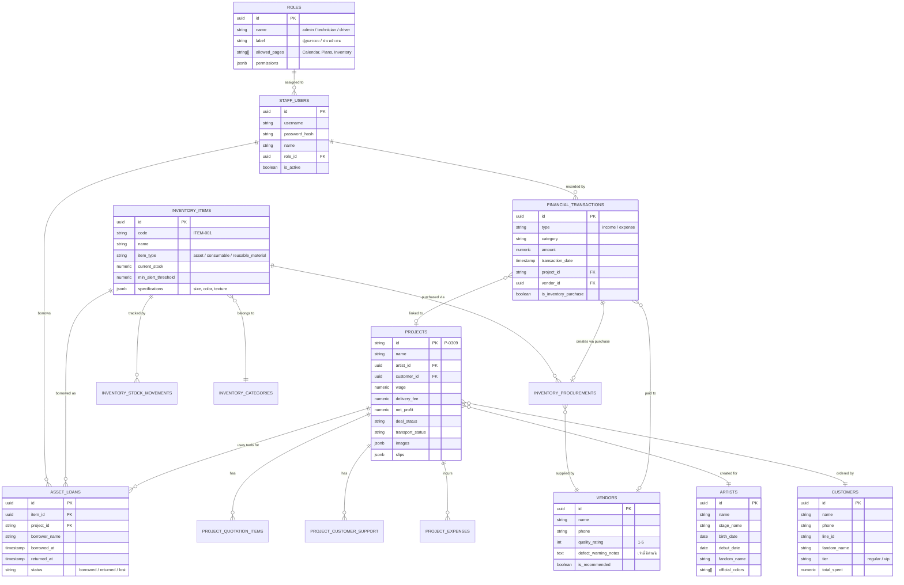
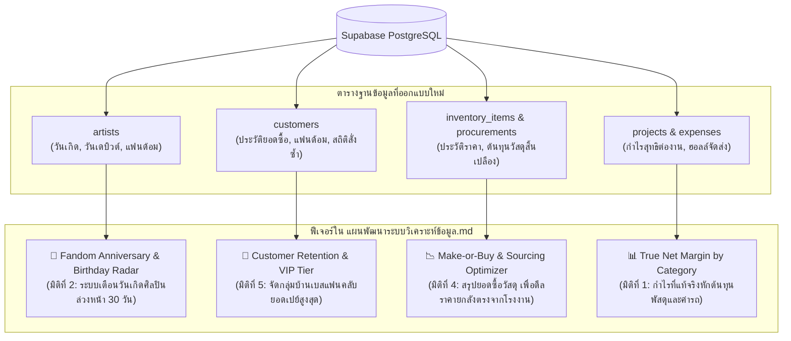
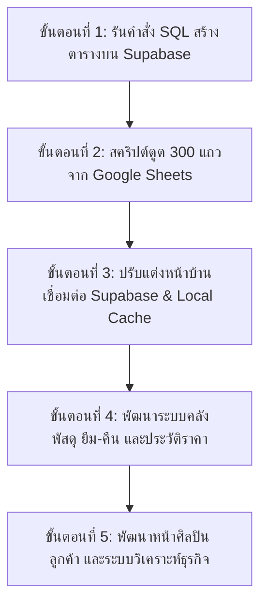

# พิมพ์เขียวโครงสร้างฐานข้อมูล Supabase และแผนพัฒนาระบบในอนาคต
## F2U Unified Database Schema & Enterprise Expansion Plan (Flower2you)

> **วัตถุประสงค์**: ออกแบบสถาปัตยกรรมฐานข้อมูลเชิงสัมพันธ์ (Relational PostgreSQL) บน Supabase ให้รองรับข้อมูล 300+ แถวเดิมจาก Google Sheets พร้อมทั้งวางโครงสร้างตารางล่วงหน้าสำหรับ **4 ระบบใหม่ในอนาคต** (ระบบการเงินแยกโปรเจกต์, ระบบคลังพัสดุ/ยืม-คืนอุปกรณ์/เปรียบเทียบราคาซัพพลายเออร์, ระบบฐานข้อมูลศิลปิน, และระบบลูกค้าสัมพันธ์ CRM) โดยยังคงยึดมั่นในยุทธศาสตร์ **Zero-Egress** และ **Local-First Architecture**

---

## สารบัญ
1. [วิเคราะห์โครงสร้างข้อมูลเดิม (Google Sheets Legacy Analysis)](#1-วิเคราะห์โครงสร้างข้อมูลเดิม-google-sheets-legacy-analysis)
2. [แผนผังความสัมพันธ์เอนทิตี (Unified Entity-Relationship Diagram)](#2-แผนผังความสัมพันธ์เอนทิตี-unified-entity-relationship-diagram)
3. [ตารางฐานข้อมูล 9 โดเมนหลัก (9 Core Database Domains)](#3-ตารางฐานข้อมูล-9-โดเมนหลัก-9-core-database-domains)
4. [กลไกอัตโนมัติข้ามระบบ (Automated Cross-Module Pipelines)](#4-กลไกอัตโนมัติข้ามระบบ-automated-cross-module-pipelines)
   - [4.1 ท่อส่งข้อมูล: บันทึกรายจ่าย ➔ ดันเข้าคลังสินค้าอัตโนมัติ (Expense-to-Inventory Flow)](#41-ท่อส่งข้อมูล-บันทึกรายจ่าย--ดันเข้าคลังสินค้าอัตโนมัติ-expense-to-inventory-flow)
   - [4.2 ระบบควบคุมอุปกรณ์ยืม-คืน & วัสดุสิ้นเปลือง (Tool Lending & Consumables Engine)](#42-ระบบควบคุมอุปกรณ์ยืม-คืน--วัสดุสิ้นเปลือง-tool-lending--consumables-engine)
   - [4.3 วงจรนำวัสดุกลับมาใช้ซ้ำ (Reusable Materials & Salvage Cycle: ดอกไม้พลาสติก)](#43-วงจรนำวัสดุกลับมาใช้ซ้ำ-reusable-materials--salvage-cycle-ดอกไม้พลาสติก)
   - [4.4 ระบบอัจฉริยะประวัติการจัดซื้อและแจ้งเตือนคู่ค้า (Vendor Intelligence & Defect Shield)](#44-ระบบอัจฉริยะประวัติการจัดซื้อและแจ้งเตือนคู่ค้า-vendor-intelligence--defect-shield)
   - [4.5 ระบบพนักงานและกำหนดสิทธิ์เข้าถึงเมนู (Role-Based Access Control - RBAC)](#45-ระบบพนักงานและกำหนดสิทธิ์เข้าถึงเมนู-role-based-access-control---rbac)
5. [การเชื่อมโยงสู่ระบบวิเคราะห์ข้อมูล (Integration with Analytics Roadmap)](#5-การเชื่อมโยงสู่ระบบวิเคราะห์ข้อมูล-integration-with-analytics-roadmap)
6. [สคริปต์โครงสร้างตาราง SQL (PostgreSQL DDL Production Script)](#6-สคริปต์โครงสร้างตาราง-sql-postgresql-ddl-production-script)
7. [ลำดับขั้นตอนการปฏิบัติการ (Implementation Roadmap)](#7-ลำดับขั้นตอนการปฏิบัติการ-implementation-roadmap)

---

## 1. วิเคราะห์โครงสร้างข้อมูลเดิม (Google Sheets Legacy Analysis)

จากการตรวจสอบ API ของ Google Apps Script (`.../exec`) พบว่าข้อมูลเดิม 300+ แถวจัดเก็บในลักษณะ **กึ่งเชิงสัมพันธ์ (Semi-Structured JSON)** แบ่งออกเป็น 2 ส่วนหลัก:

1. **ชีท `Projects`**:
   - ฟิลด์หลัก: `id (P-xxxx)`, `name`, `category`, `artist`, `customer`, `customerInfo (JSON)`, `date`, `rawDateTime`, `deliveryDate`, `wage`, `deliveryFee`, `dealStatus`, `transportStatus`, `location`, `mapLink`, `recipient`, `recipientPhone`, `note`, `image (Google Drive URL)`
   - ฟิลด์อาร์เรย์ซ้อน (Nested JSON Arrays):
     - `quotationItems`: รายการเสนอราคา (category, detail, price, quantity, unitPrice)
     - `expenses`: รายการค่าใช้จ่ายเฉพาะงาน (category, detail, price, quantity, unitPrice)
     - `customerSupport`: รายการเงินสนับสนุนศิลปินแยกตามแบงค์ (denomination, quantity, price)
2. **ชีท `Settings`**:
   - `project_categories`: รายชื่อหมวดหมู่งาน (Backdrop, ช่อถือ, ช่อขาตั้ง, standee ติดเงิน, ฯลฯ)
   - `project_expenses`: หมวดหมู่รายจ่ายประจำ (ค่าจ้าง, ค่าอุปกรณ์, ค่าเดินทาง, ค่าที่พัก, ฯลฯ)
   - `deal_statuses`: สถานะการปิดดีล (Operating, ยืนยันแล้ว, จัดส่งแล้ว, ฯลฯ)
   - `transport_statuses`: สถานะการจัดส่ง (Preparing, In Transit, Delivered, ฯลฯ)

> [!IMPORTANT]
> **ข้อสังเกตเชิงสถาปัตยกรรม**: ข้อมูลเดิมใช้การพิมพ์ชื่อศิลปิน (`artist`) และลูกค้า (`customer`) เป็นข้อความธรรมดา (String) ส่งผลให้เกิดปัญหาชื่อสะกดไม่ตรงกัน (เช่น เว้นวรรคไม่เท่ากัน หรือพิมพ์ผิด) เมื่อนำไปทำกราฟวิเคราะห์ใน [`แผนพัฒนาระบบวิเคราะห์ข้อมูล.md`](file:///d:/WebappDreame/Flower2U/แผนพัฒนาระบบวิเคราะห์ข้อมูล.md) จะทำให้ระบบนับแยกเป็นคนละคน ดังนั้นในฐานข้อมูลใหม่บน Supabase เราจะสร้าง **ตารางแม่ (Master Table)** ของ `artists` และ `customers` เพื่อเก็บประวัติที่ถูกต้องและผูก Foreign Key ได้ 100%

---

## 2. แผนผังความสัมพันธ์เอนทิตี (Unified Entity-Relationship Diagram)



---

## 3. ตารางฐานข้อมูล 8 โดเมนหลัก (8 Core Database Domains)

ฐานข้อมูลใหม่บน Supabase (PostgreSQL) จะถูกจัดกลุ่มเป็น 8 โดเมนอย่างเป็นระเบียบ:

| โดเมนที่ | ชื่อตารางบน Supabase | หน้าที่และความรับผิดชอบ (Domain Responsibility) |
| :---: | :--- | :--- |
| **1** | `roles`, `staff_users` | **[ใหม่]** ทะเบียนพัสดุและสิทธิ์เข้าถึง (RBAC): กำหนดว่า Role ไหนเข้าหน้าไหนได้บ้าง และบัญชีพนักงาน |
| **2** | `projects` | ข้อมูลโปรเจกต์งานหลัก 302 งานเดิม (`P-xxxx`) พร้อมฟิลด์เวอร์ชันสำหรับ Optimistic Lock |
| **3** | `deleted_records` | ตาราง Tombstone บันทึกประวัติแถวที่ถูกลบสำหรับระบบ Background Delta Sync |
| **4** | `financial_transactions` | บัญชีรายรับ-รายจ่ายอิสระ (ทั้งที่ผูกกับโปรเจกต์ และค่าใช้จ่ายทั่วไปของร้าน) |
| **5** | `inventory_items`, `inventory_categories` | ทะเบียนพัสดุและคลังสินค้า (แยกประเภท: อุปกรณ์ยืม-คืน, วัสดุสิ้นเปลือง, วัสดุหมุนเวียน) |
| **6** | `inventory_procurements`, `inventory_stock_movements` | ประวัติราคาจัดซื้อ (Price Radar) และบันทึกการเคลื่อนไหวสต็อก |
| **7** | `asset_loans` | ทะเบียนควบคุมการยืม-คืนเครื่องมือและอุปกรณ์ออกนอกสถานที่ ผูกกับช่างและงาน |
| **8** | `vendors` | ทะเบียนร้านค้า/คู่ค้าจัดซื้อ พร้อมระบบให้คะแนนและบันทึกประวัติสินค้ามีตำหนิ |
| **9** | `artists`, `customers` | ฐานข้อมูลศิลปิน (วันเกิด/วันเดบิวต์/แฟนด้อม) และฐานข้อมูลลูกค้าสัมพันธ์ (CRM/VIP) |

---

## 4. กลไกอัตโนมัติข้ามระบบ (Automated Cross-Module Pipelines)

### 4.1 ท่อส่งข้อมูล: บันทึกรายจ่าย ➔ ดันเข้าคลังสินค้าอัตโนมัติ (Expense-to-Inventory Flow)
เมื่อพนักงานกดเพิ่ม **"รายจ่าย (Expense)"** ในระบบการเงิน:
1. หากเลือกสวิตช์ `ซื้อของเข้าคลัง/พัสดุ (is_inventory_purchase = true)`:
   - ระบบจะเปิดช่องให้เลือก **"สินค้าในคลัง (inventory_item_id)"** หรือ **"สร้างสินค้าใหม่"**
   - ให้ระบุจำนวนที่ซื้อ (`quantity`), ราคาต่อหน่วย (`unit_price`), และร้านค้าที่ซื้อ (`vendor_id`)
2. เมื่อกด **"บันทึกรายจ่าย"**:
   - ระบบจะสร้างเรคคอร์ดใน `financial_transactions` เพื่อตัดยอดเงินในบัญชี
   - ระบบจะสร้างเรคคอร์ดใน `inventory_procurements` บันทึกประวัติราคา
   - **PostgreSQL Database Trigger** จะเพิ่มจำนวนสต็อกใน `inventory_items.current_stock` ให้ทันทีโดยอัตโนมัติ

### 4.2 ระบบควบคุมอุปกรณ์ยืม-คืน & วัสดุสิ้นเปลือง (Tool Lending & Consumables Engine)
จำแนกสิ่งของในร้านออกเป็น 3 ประเภททางวิศวกรรม (`item_type`):
1. **อุปกรณ์ถาวร/เครื่องมือ (Asset / Tool - ยืมแล้วต้องคืน)**:
   - *ตัวอย่าง*: กรรไกรตัดดอกไม้, ปืนกาวร้อน, โครงเหล็ก Backdrop, บันไดช่าง, ปลั๊กพ่วง, ตลับเมตร
   - *การทำงาน*: มีหน้าต่างสแกน QR Code หรือเลือกชื่อพนักงาน (`borrower_name`) ผูกกับโปรเจกต์ (`project_id`) เมื่อนำออกไปทำงานนอกสถานที่ สถานะจะเปลี่ยนเป็น `borrowed` เมื่อนำกลับมาส่งคืน พนักงานกดตรวจรับและเช็กสภาพ (`good / damaged`) สถานะจะกลับเป็น `available`
2. **วัสดุสิ้นเปลือง / ใช้แล้วหมดไป (Consumable - เบิกแล้วตัดสต็อก)**:
   - *ตัวอย่าง*: เทปใส, ไส้ปืนกาว, แผ่นโฟม, กาวสองหน้า, ริบบิ้น, ก้านลูกโป่ง, ดอกไม้สด
   - *การทำงาน*: มีการตัดยอดตามจำนวนที่เบิกใช้จริง และมีระบบตั้งเกณฑ์เตือนภัยสต็อกต่ำ (`min_alert_threshold`) เช่น *ถ้าเทปใสเหลือ < 5 ม้วน ให้ขึ้นแถบเตือนสีแดงในหน้าคลังทันที*
   - *คุณลักษณะเฉพาะ (Variant Attributes ใน JSONB)*:
     - **กระดาษห่อ**: เก็บคุณสมบัติประเภทกระดาษ (ด้าน, มัน, ฟิล์มใส, ตาข่าย), ขนาด (50x70 cm), สี (ขาว, ดำ, ชมพูพาสเทล), พื้นผิว (Waterproof, Matte)
     - **ดอกไม้สด**: เก็บเกรดดอกไม้, แหล่งที่มา (ปากคลองตลาด, นำเข้าจากคุนหมิง)

### 4.3 วงจรนำวัสดุกลับมาใช้ซ้ำ (Reusable Materials & Salvage Cycle: ดอกไม้พลาสติก)
- **ดอกไม้พลาสติก / ดอกไม้ประดิษฐ์ / ขาตั้งไม้**: 
  - เมื่อนำไปใช้งานในโปรเจกต์ A: สต็อกในคลังจะถูกหักออกตามจำนวนที่ใช้จริง
  - เมื่อจบงานและรื้อถอน (Tear-down): ช่างสามารถเปิดระบบหน้างาน แล้วกด **"นำกลับเข้าคลัง (Return to Stock)"**
  - ระบบจะให้กรอกจำนวนที่ยังสภาพดี เช่น *เบิกไป 50 ดอก สภาพดีนำกลับมา 42 ดอก ชำรุดทิ้ง 8 ดอก*
  - สต็อกในคลังจะถูกบวกกลับเข้าไปอัตโนมัติ 42 ดอก พร้อมบันทึก Loss/Damage 8 ดอกเข้าต้นทุนงานทันที

### 4.4 ระบบอัจฉริยะประวัติการจัดซื้อและแจ้งเตือนคู่ค้า (Vendor Intelligence & Defect Shield)
1. **ประวัติราคาจัดซื้อในอดีต (Historical Price Radar)**:
   - ทุกครั้งที่มีการซื้อของ ระบบจะบันทึก `purchase_date`, `unit_price`, `vendor_id`
   - เมื่อต้องการซื้อกระดาษห่อหรือดอกไม้พลาสติกล็อตใหม่ พนักงานสามารถกดดู **"กราฟเปรียบเทียบราคา"** ได้ทันทีว่า *ร้าน A เคยขาย 120 บาท, ร้าน B เคยขาย 110 บาท, ร้าน C เคยขาย 135 บาท*
2. **ป้ายเตือนร้านค้าที่สินค้ามีตำหนิ (Defect & Quality Warning)**:
   - หากเคยซื้อจากร้านไหนแล้วสินค้ามีปัญหา เช่น *โครงเบี้ยว, กลีบดอกไม้หลุดง่าย, สีกระดาษตก* พนักงานจะใส่คะแนนดาว (`quality_rating`) และบันทึกหมายเหตุ (`defect_warning_notes`)
   - ในครั้งต่อไป เมื่อพนักงานเลือกชื่อร้านนี้ในระบบ จะมี **Badge สีแดงแจ้งเตือนขึ้นมาบนหน้าจอทันที**:
     > ⚠️ **คำเตือนจากประวัติการซื้อ**: ร้านนี้เคยส่งสินค้ามีตำหนิ ("กลีบดอกไม้หลุดง่าย กาวไม่แน่น - บันทึกเมื่อ 12 ต.ค. 2569") กรุณาตรวจสอบสินค้าก่อนชำระเงิน

### 4.5 ระบบพนักงานและกำหนดสิทธิ์เข้าถึงเมนู (Role-Based Access Control - RBAC)
ระบบจัดสิทธิ์การเข้าใช้งานแบบไดนามิก โดยแอดมินสามารถกำหนดผ่านหน้า "ตั้งค่า (Settings)" ได้เอง:
1. **การกำหนดสิทธิ์ของแต่ละบทบาท (Role Permission Mapping)**:
   - ตาราง `roles` จะมีคอลัมน์ `allowed_pages TEXT[]` ระบุรายชื่อแท็บเมนูที่บทบาทนั้นได้รับอนุญาต เช่น:
     - **ช่างจัดดอกไม้/หน้างาน (`technician`)**: `{"Calendar", "Plans", "Inventory"}` ➔ เข้าดูปฏิทินงาน ดูใบงาน และเบิก-คืนเครื่องมือในคลังได้ **แต่จะมองไม่เห็นแท็บ "การเงิน (Finance)", "วิเคราะห์ (Analytics)", "พนักงาน (Staff)" และ "ตั้งค่า (Settings)" เลย**
     - **คนขับรถส่งของ (`driver`)**: `{"Calendar", "Plans"}` ➔ ดูสถานที่จัดส่ง แผนที่ และอัปเดตสถานะขนส่งได้เท่านั้น
     - **ฝ่ายบัญชี (`accountant`)**: `{"Calendar", "Plans", "Finance", "Analytics"}` ➔ ดูแลงาน ใบเสนอราคา และสรุปรายรับ-รายจ่าย
     - **ผู้ดูแลระบบ (`admin`)**: `{"Calendar", "Plans", "Finance", "Analytics", "Inventory", "Staff", "Settings"}` ➔ เข้าถึงได้ครบทุกหน้า 100%
2. **การทำงานที่หน้าบ้าน (Client Dynamic Navigation Filtering)**:
   - เมื่อพนักงานล็อกอินสำเร็จ ระบบจะอ่าน `userProfile.role.allowed_pages`
   - แถบเมนูด้านล่าง (Bottom Navigation) และแถบด้านข้างจะถูกกรอง (`filter`) ให้เหลือเฉพาะปุ่มที่พนักงานคนนั้นมีสิทธิ์เข้าถึง
   - หากพนักงานพยายามพิมพ์ URL ลัดเข้าไปตรงๆ (เช่น `/finance`) ตัว Router จะดักจับและดีดกลับไปหน้า `/plans` พร้อมแจ้งเตือน "คุณไม่มีสิทธิ์เข้าถึงหน้านี้" ทันที

---

### 4.6 กฎเหล็กทางบัญชีสากลเรื่องการรันเลขที่บิล และการจัดการบิลที่ถูกลบ (Accounting Audit Integrity)
> คำถามสำคัญ: *"ถ้าบิล 0001-0100 แล้วบิลที่ 0005 โดนลบไป ตามหลักบัญชีต้องทำยังไง? เพิ่มเป็น 0101 หรือใช้ 0005? แล้วถ้าผู้สอบบัญชีถามว่า 0005 หายไปไหน จะทำอย่างไร?"*

ในมาตรฐานการบัญชีสากลและกรมสรรพากร (Tax & Audit Standards) มีกฎตายตัวดังนี้:
1. **ห้ามนำเลขบิลเดิมที่เคยลบหรือยกเลิกไปแล้วกลับมาใช้ซ้ำเด็ดขาด (Never Reuse a Voucher Number)**:
   - บิลใบใหม่ถัดไป **จะต้องรันเป็น 0101 เสมอ**
   - *เหตุผล*: หากนำเลข 0005 มาใช้ซ้ำ จะเกิดความเสี่ยงร้ายแรง เช่น เอกสารใบเดิมอาจเคยถูกส่งให้ลูกค้าหรือคู่ค้าไปแล้ว เมื่อนำเลขเดิมมาออกใหม่ จะกลายเป็น **"เอกสารซ้ำซ้อนสองฉบับในระบบ"** ซึ่งผิดกฎหมายภาษีและมาตรฐานบัญชี
2. **ห้ามลบแถวออกจากฐานข้อมูลจริง (Never Hard Delete) ➔ ให้ใช้วิธี "ยกเลิกเอกสาร (VOID)"**:
   - ในระบบการเงินของ Flower2U เมื่อมีการกดลบหรือยกเลิกบิล 0005 ระบบจะไม่ยิงคำสั่ง `DELETE`
   - แต่ระบบจะเปลี่ยนสถานะเป็น `status = 'void'`
   - พร้อมบันทึก **"เหตุผลที่ยกเลิก (`void_reason`)"** เช่น *ระบุราคาผิด, ลูกค้ายกเลิกออเดอร์*, บันทึกว่า **ใครเป็นคนกดยกเลิก (`voided_by`)** และ **ยกเลิกเมื่อไหร่ (`voided_at`)**
   - ยอดเงินของบิลที่ยกเลิกจะไม่ถูกนำไปคำนวณในงบรายรับ-รายจ่ายจริง (ถือเป็น 0 บาท)
3. **เมื่อผู้สอบบัญชีหรือสรรพากรมาตรวจ**:
   - ผู้ตรวจสอบจะตรวจดูความต่อเนื่องของตัวเลข (Sequential Audit Trail): *0001, 0002, 0003, 0004, 0005 (ขึ้นสถานะสีแดงว่า VOID/ยกเลิก พร้อมเหตุผลและชื่อคนยกเลิก), 0006...*
   - ผู้สอบบัญชีจะให้ผ่านทันที $100%$ เพราะเลขเรียงต่อเนื่องครบทุกใบ มีที่มาที่ไปชัดเจน ไม่ถูกตั้งข้อสงสัยว่าแอบลบทิ้งเพื่อซ่อนรายได้หนีภาษี

---

### 4.7 สถาปัตยกรรมการเชื่อมโยงข้อมูลข้ามหน้า (Cross-Page Deep Linking & In-Memory Lookups)
ระบบได้รับการออกแบบให้ทุกหน้าสามารถเรียกชื่อและคลิกข้ามหน้าหากันได้แบบ Seamless:
1. **หน้าการเงิน (Finance) ➔ หน้าโปรเจกต์งาน (Projects)**:
   - บิลรายรับ-รายจ่ายที่มีการผูก `project_id (เช่น P-0309)` จะแสดงเป็น Badge ลิงก์สี Indigo
   - เมื่อคลิก จะเปิด Modal รายละเอียดของโปรเจกต์ P-0309 ขึ้นมาดูได้ทันที
2. **หน้าโปรเจกต์ (Projects) ➔ หน้าศิลปิน (Artists) & หน้าลูกค้า (Customers)**:
   - ช่องศิลปินและชื่อลูกค้าในหน้างาน เมื่อคลิกจะนำทางไปยังหน้าข้อมูลศิลปิน (แสดงวันเกิด/คิวงานทั้งหมดของศิลปินคนนั้น) หรือหน้าประวัติลูกค้า (ยอดซื้อสะสม/ระดับ VIP)
3. **หน้าคลังพัสดุ (Inventory) ➔ หน้าประวัติการจัดซื้อและซัพพลายเออร์ (Vendors)**:
   - เมื่อดูของในคลัง เช่น กระดาษสีชมพูด้าน สามารถคลิกชื่อร้านค้าเพื่อดูประวัติราคา และป้ายเตือนของมีตำหนิได้ทันที
4. **ความเร็วสูงระดับ 0ms และ 0 Bytes Egress**:
   - เนื่องจากระบบใช้ **Local-First Architecture (Dexie.js)** ข้อมูลทั้งหมดถูกทำดัชนี Index ไว้ใน IndexedDB ของเครื่องผู้ใช้แล้ว
   - การคลิกเชื่อมโยงข้ามหน้าทั้งหมดจึงเกิดขึ้นในหน่วยความจำเครื่อง (In-Memory) ทันทีใน $0.1$ มิลลิวินาที โดยไม่ต้องส่ง Request ข้ามอินเทอร์เน็ตแม้แต่ไบต์เดียว!

---

### 4.8 ระบบตัดจ่ายพัสดุอุปกรณ์ชำรุด-สูญหาย-หมดคม (Asset Disposal & Decommissioning: "อันนี้ไม่มีแล้วนะ")
อุปกรณ์ทำงานของร้านดอกไม้ เช่น กรรไกร แท่นตัดเทป ปืนกาว โครงแบคดรอป มีอายุการใช้งาน สามารถ **พัง แตกหัก หมดคม ลับไม่ได้ หรือช่างทำหายหน้างาน** ระบบจึงออกแบบกลไก "ตัดจำหน่าย (Disposal / Write-Off)" โดยเฉพาะ:

1. **ช่องสถานะบอกความพร้อมใช้งานในตาราง `inventory_items`**:
   - `status`: 
     - `in_service` = พร้อมใช้งาน / ของอยู่ในร้าน
     - `maintenance` = กำลังส่งซ่อม / ลับคมใบมีด (ยังไม่ตัดทิ้ง)
     - `low_stock` = ใกล้หมดสต็อก
     - `out_of_stock` = หมดชั่วคราว (รอซื้อเติม)
     - `written_off` = **"อันนี้ไม่มีแล้วนะ" (ตัดจ่าย / ปลดระวางถาวร จากการพังหรือหมดคม)**
     - `lost` = **"สูญหาย" (ทำหายหน้างาน หรือหาไม่พบ)**
   - `is_active`: เมื่อของถูกตัดจ่ายจนหมดหรือปลดระวางถาวร ฟิลด์นี้จะเปลี่ยนเป็น `false` เพื่อ **ซ่อนไม่ให้โชว์เกะกะในเมนูเบิกของ** แต่ข้อมูลประวัติยังคงอยู่ในฐานข้อมูล ไม่หายไปไหน
   - `decommission_reason`: ข้อความระบุเหตุผล เช่น *"กรรไกรซิกแซกหมดคม ลับ 3 ครั้งแล้วตัดไม่เข้า", "แท่นตัดเทปตกพื้นแกนเหล็กแตก"*
   - `decommissioned_at` และ `decommissioned_by_user_id`: บันทึกวันเวลาและชื่อพนักงานที่แจ้งตัดจ่าย
2. **ตารางบันทึกประวัติการตัดจ่าย `inventory_disposals` (Audit Trail)**:
   - บันทึกรหัสเอกสาร `DSP-YYMMDD-xxxx`
   - เก็บจำนวนที่ตัดจำหน่าย, ประเภทสาเหตุ (`damaged`, `worn_out_dull`, `lost`, `broken_on_site`)
   - แนบรูปถ่ายหลักฐานสภาพของชำรุดเก็บบน Google Drive (`proof_image_url`)
   - สามารถผูกกับงานโปรเจกต์ (`project_id`) ได้ทันที ทำให้รู้ว่าของชิ้นนี้พังหรือหายที่งานอีเวนต์ไหน
3. **ระบบตัดสต็อกอัตโนมัติ (Automated Trigger)**:
   - ทันทีที่บันทึกตัดจ่าย ระบบจะหัก `current_stock` ออกอัตโนมัติ
   - คำนวณมูลค่าความเสียหายทางบัญชี (`financial_loss = จำนวน x ราคาต้นทุนเฉลี่ย`) เพื่อส่งไปแสดงในหน้าสรุปผลประกอบการ

---

### 4.9 มาตรฐานการตั้งรหัสสินค้าและพัสดุแบบสั้น กระชับ จำง่าย (Simple Short Code ID)
เพื่อความสะดวกสูงสุดในการใช้งานจริงของทีมงานหน้าร้านและช่างจัดดอกไม้ ไม่ต้องพิมพ์ยาวหรือจำตัวย่อภาษาอังกฤษให้ปวดหัว รหัสสินค้าจะใช้รูปแบบตัวเลขรันสั้นๆ จำง่าย ค้นหาเร็ว:

#### แบบที่ 1: รหัสเดียวจำง่ายที่สุดในโลก (Universal Simple Code - แนะนำ)
ใช้รูปแบบ `item0001`, `item0002` รันต่อเนื่องกันไปเลย:
- พิมพ์ค้นหาเร็วมาก: พิมพ์แค่ `1` หรือ `item1` ในช่อง Search ก็เจอทันที
- ตัวอย่าง:
  - `item0001`: กรรไกรตัดแต่งกิ่งไม้
  - `item0002`: กรรไกรตัดริบบิ้น
  - `item0003`: แท่นตัดเทปตั้งโต๊ะ
  - `item0004`: ปืนยิงกาวร้อน
  - `item0005`: เทปใส 2 นิ้ว
  - `item0006`: ไส้กาวร้อนแท่งเล็ก
  - `item0007`: โอเอซิสดอกไม้สด
  - `item0008`: ดอกกุหลาบพลาสติกสีส้ม
  - `item0009`: ดอกทิวลิปพลาสติกสีส้ม
  - `item0010`: ดอกไฮเดรนเยียพลาสติกสีส้ม

---

#### แบบที่ 2: รหัสสั้นแยกตามหมวดหมู่หลัก 3 หมวด (Short Category Prefix)
หากต้องการให้มองเห็นรหัสแล้วรู้ทันทีว่าเป็นของประเภทไหน โดยยังคงสั้นและจำง่าย:
1. **หมวดเครื่องมือ/อุปกรณ์ (`eq`)**:
   - `eq0001`: กรรไกรตัดกิ่ง
   - `eq0002`: แท่นตัดเทป
   - `eq0003`: ปืนยิงกาว
   - `eq0004`: คีมตัดลวด
2. **หมวดวัสดุสิ้นเปลือง (`mat`)**:
   - `mat0001`: เทปใส 2 นิ้ว
   - `mat0002`: ไส้กาวแท่ง
   - `mat0003`: โอเอซิสฟลอรัลโฟม
   - `mat0004`: ลวดเขียวเบอร์ 24
3. **หมวดดอกไม้พลาสติก (`flw`)**:
   - `flw0001`: ดอกไม้พลาสติกสีส้ม (กุหลาบ)
   - `flw0002`: ดอกไม้พลาสติกสีส้ม (ทิวลิป)
   - `flw0003`: ดอกไม้พลาสติกสีชมพู

*ระบบหน้าบ้านจะมีระบบ Live Search ที่พิมพ์ได้ทั้งรหัสสั้น (เช่น `0001`), ชื่อสินค้า (เช่น `กรรไกร`, `เทป`, `ส้ม`), หรือสี ทำให้ไม่จำเป็นต้องจำรหัสยาวๆ อีกต่อไป*

---

### 4.10 ทำไมการแยกคอลัมน์และตารางลูกจึงช่วยประหยัด Egress สู่จุดขีดสุด (Maximum Zero-Egress Proof)
> ข้อกังวล: *"พอแยกแบบนี้ ตอนเพิ่ม-ลบพัสดุอุปกรณ์จะไม่เป็นปัญหาเรื่อง Egress ใช่มั้ย?"*

คำตอบเชิงวิศวกรรมคือ: **การแยกตารางแบบนี้ ยิ่งทำให้ประหยัด Egress มากกว่าการเก็บเป็นก้อน JSON แบบเดิมหลายเท่าตัว!** เพราะ:
1. **การอัปเดตแบบแม่นยำระดับแถว (Granular Mutation)**:
   - *แบบ JSON เดิม*: ถ้าคุณมีวัสดุ 50 ชิ้น แล้วแก้ไขสต็อกกาว 1 หลอด คุณต้องส่งก้อน JSON ขนาดใหญ่ที่มีข้อมูลทั้ง 50 ชิ้นกลับไปกลับมา
   - *แบบแยกตารางใหม่*: คุณยิงอัปเดตเฉพาะแถวเดียว (`UPDATE inventory_items SET current_stock = 12 WHERE id = ...`) ใช้ปริมาณข้อมูลเพียง **~80 Bytes** เท่านั้น!
2. **Ingress ฟรี 100% ไม่จำกัด**:
   - การส่งข้อมูลเข้า Supabase (เช่น เพิ่มของเข้าคลัง, เบิกของ, บันทึกรายจ่าย) นับเป็น **Ingress** ซึ่งบน Supabase Free Tier ให้ใช้งานฟรีได้ไม่จำกัดจำนวนครั้งและไม่จำกัด GB!
3. **Egress คุมได้ 99% ด้วย Delta Sync & Server-Side Aggregations**:
   - หน้าคลังพัสดุใช้ระบบ **Local-First**: เปิดหน้าจอขึ้นมา อ่านสต็อกจาก IndexedDB ในเครื่องทันที (0 Egress)
   - ตัวเลขสรุปบนหัวการ์ด (เช่น มูลค่าสต็อกรวม, จำนวนของที่ใกล้หมด) ใช้ฟังก์ชัน RPC `get_inventory_analytics()` ให้เซิร์ฟเวอร์คำนวณแล้วส่งกลับมาเป็นก้อนตัวเลขขนาดเพียง **~80 Bytes** ไม่ต้องดึงรายการพัสดุทั้งหมดมานับที่หน้าบ้าน!

---

## 5. การเชื่อมโยงสู่ระบบวิเคราะห์ข้อมูล (Integration with Analytics Roadmap)

โครงสร้างฐานข้อมูลใหม่นี้ออกแบบมารองรับฟังก์ชันใน [`แผนพัฒนาระบบวิเคราะห์ข้อมูล.md`](file:///d:/WebappDreame/Flower2U/แผนพัฒนาระบบวิเคราะห์ข้อมูล.md) ได้อย่างไร้รอยต่อ:



1. **Birthday & Anniversary Radar (เรดาร์วันเกิดศิลปิน)**:
   - ตาราง `artists` เก็บ `birth_date` และ `debut_date` ไว้อย่างชัดเจน
   - หน้าวิเคราะห์สามารถรัน SQL View สรุปได้ทันทีว่า *ในอีก 30 วันข้างหน้า มีศิลปินคนไหนกำลังจะถึงวันเกิดบ้าง* เพื่อให้ทีมงานทักไปเปิดรับออเดอร์กับบ้านเบสก่อนคู่แข่ง
2. **Fandom Spending Power (กำลังซื้อของแฟนด้อม)**:
   - ตาราง `customers` และ `projects` ผูกกับ `artist_id`
   - สามารถสรุปอันดับได้ว่า *แฟนด้อมวงไหนมียอดสั่งซื้อสะสมรวมสูงสุดในรอบปี*
3. **Make-or-Buy Analysis (วิเคราะห์ความคุ้มค่าการซื้อเครื่องจักร)**:
   - ตาราง `financial_transactions` และ `inventory_items` แยกหมวดหมู่วัสดุชัดเจน
   - เมื่อหมวด "ค่าปริ้นป้าย/ไวนิล" มียอดรวมสะสมเกินเกณฑ์ ระบบจะแนะนำความคุ้มทุนในการซื้อเครื่องพิมพ์เองได้แม่นยำ

---

## 6. สคริปต์โครงสร้างตาราง SQL ฉบับมาสเตอร์แบบแยกคอลัมน์สมบูรณ์ (100% Normalized Pure-Relational DDL)

> [!IMPORTANT]
> **มาตรฐานการจัดเก็บข้อมูลแบบแยกคอลัมน์ (Zero-JSON Schema)**:
> ตามข้อกำหนดของคุณ สคริปต์นี้ได้รับการออกแบบใหม่โดย **ไม่เก็บข้อมูลเป็น JSON** ในฟิลด์ที่ต้องกรอกข้อมูลจริง ทุกฟิลด์ในฟอร์มของระบบ (ข้อมูลลูกค้า, การจัดส่ง, ใบเสนอราคา, เงินสนับสนุนศิลปิน, ค่าใช้จ่าย, สเปกสินค้าในคลัง) จะถูกแยกออกเป็น **คอลัมน์อิสระ (First-Class Columns)** และ **ตารางลูกแบบสัมพันธ์ (Normalized Child Tables)** 100%:
> 1. **ข้อมูลลูกค้าในตาราง Projects**: แยกเป็นคอลัมน์ `customer_social`, `customer_line`, `customer_phone`, `customer_email`, `customer_tax_id`, `customer_address`
> 2. **ใบเสนอราคา (Quotation)**: แยกเป็นตารางลูก `project_quotation_items` (category, detail, quantity, unit_price, price, item_date, sort_order)
> 3. **เงินสนับสนุนศิลปิน (Money Order / ธนบัตร)**: แยกเป็นตารางลูก `project_customer_support` (denomination, quantity, price, item_date, sort_order)
> 4. **ต้นทุนค่าใช้จ่ายเฉพาะงาน (Expenses)**: แยกเป็นตารางลูก `project_expenses` (category, detail, quantity, unit_price, price, item_date, sort_order)
> 5. **พัสดุในคลัง (Inventory Specifications)**: แยกเป็นคอลัมน์ `color`, `size`, `texture_type`, `material_grade`
> 6. **ตั้งค่าร้านค้า (Shop Settings)**: แยกเป็นตาราง `shop_settings` เก็บเบอร์โทร โซเชียลทุกแพลตฟอร์ม โฟลเดอร์ Drive และโทเค็นบอทแยกช่องชัดเจน
> 
> *ผลลัพธ์: หน้าบ้านสามารถคิวรีและบันทึกข้อมูลได้ตรงๆ ทันที ไม่ต้องเขียนฟังก์ชัน `JSON.parse()` หรือแยกฟิลด์เองในหน่วยความจำเบราว์เซอร์ ข้อมูลไม่มีทางตกหล่นหรือเพี้ยนแน่นอน!*

```sql
-- ==============================================================================
-- FLOWER2U (F2U) 100% NORMALIZED PURE-RELATIONAL MASTER PRODUCTION DDL
-- Version: 3.0 Enterprise (Zero-JSON for Form Fields + RBAC + Inventory + RPC)
-- ==============================================================================

-- 1. เปิดใช้ Extension สำหรับสร้าง UUID
CREATE EXTENSION IF NOT EXISTS "uuid-ossp";

-- ==============================================================================
-- โดเมนที่ 1: ระบบจัดการบทบาทและสิทธิ์พนักงาน (RBAC & Staff Users)
-- ==============================================================================

-- 1.1 ตารางบทบาทและสิทธิ์การเข้าถึงเมนู
CREATE TABLE IF NOT EXISTS public.roles (
    id UUID PRIMARY KEY DEFAULT uuid_generate_v4(),
    name TEXT NOT NULL UNIQUE,                 -- 'admin', 'technician', 'driver', 'accountant'
    label TEXT NOT NULL,                       -- 'ผู้ดูแลระบบ', 'ช่างหน้างาน', 'พนักงานส่งของ', 'ฝ่ายบัญชี'
    description TEXT,
    allowed_pages TEXT[] NOT NULL DEFAULT '{"Calendar", "Plans"}', -- แท็บที่เข้าถึงได้
    can_edit_pricing BOOLEAN DEFAULT false,    -- สิทธิ์แก้ไขราคา/ใบเสนอราคา
    can_delete_project BOOLEAN DEFAULT false,  -- สิทธิ์ลบงาน
    can_borrow_tools BOOLEAN DEFAULT true,     -- สิทธิ์เบิกยืมเครื่องมือในคลัง
    can_manage_users BOOLEAN DEFAULT false,    -- สิทธิ์จัดการพนักงาน
    is_system_role BOOLEAN DEFAULT false,      -- ป้องกันลบ role หลัก (admin)
    created_at TIMESTAMPTZ DEFAULT timezone('utc'::text, now()),
    updated_at TIMESTAMPTZ DEFAULT timezone('utc'::text, now())
);

-- ใส่ Role พื้นฐานเริ่มต้นทันที
INSERT INTO public.roles (name, label, description, allowed_pages, can_edit_pricing, can_delete_project, can_borrow_tools, can_manage_users, is_system_role)
VALUES 
    ('admin', 'ผู้ดูแลระบบ (Admin)', 'เข้าถึงได้ทุกหน้าและจัดการสิทธิ์ระบบ', '{"Calendar", "Plans", "Finance", "Analytics", "Inventory", "Staff", "Settings"}', true, true, true, true, true),
    ('technician', 'ช่างจัดดอกไม้/หน้างาน (Technician)', 'ดูแผนงานและเบิก-คืนอุปกรณ์คลังพัสดุ', '{"Calendar", "Plans", "Inventory"}', false, false, true, false, false),
    ('driver', 'พนักงานจัดส่ง (Driver/Logistics)', 'ดูพิกัดส่งของและอัปเดตสถานะขนส่ง', '{"Calendar", "Plans"}', false, false, false, false, false),
    ('accountant', 'ฝ่ายการเงิน/บัญชี (Accountant)', 'บันทึกรายรับ-รายจ่าย ใบเสนอราคา และวิเคราะห์กำไร', '{"Calendar", "Plans", "Finance", "Analytics"}', true, false, false, false, false)
ON CONFLICT (name) DO NOTHING;

-- 1.2 ตารางข้อมูลพนักงาน/ผู้ใช้งานระบบ
CREATE TABLE IF NOT EXISTS public.staff_users (
    id UUID PRIMARY KEY DEFAULT uuid_generate_v4(),
    username TEXT NOT NULL UNIQUE,             -- Username สำหรับล็อกอิน
    password_hash TEXT NOT NULL,               -- รหัสผ่าน
    name TEXT NOT NULL,                        -- ชื่อพนักงาน
    phone TEXT,                                -- เบอร์โทร
    role_id UUID NOT NULL REFERENCES public.roles(id) ON DELETE RESTRICT,
    avatar_url TEXT,
    is_active BOOLEAN DEFAULT true,            -- สถานะเปิดใช้งาน
    last_login_at TIMESTAMPTZ,
    created_at TIMESTAMPTZ DEFAULT timezone('utc'::text, now()),
    updated_at TIMESTAMPTZ DEFAULT timezone('utc'::text, now())
);

CREATE INDEX IF NOT EXISTS idx_staff_users_username ON public.staff_users(username);
CREATE INDEX IF NOT EXISTS idx_staff_users_role ON public.staff_users(role_id);

-- ==============================================================================
-- โดเมนที่ 2: ทะเบียนศิลปินและลูกค้า (Artists & Customer CRM)
-- ==============================================================================

-- 2.1 ตารางข้อมูลศิลปิน
CREATE TABLE IF NOT EXISTS public.artists (
    id UUID PRIMARY KEY DEFAULT uuid_generate_v4(),
    name TEXT NOT NULL UNIQUE,                 -- ชื่อศิลปิน
    stage_name TEXT,
    agency TEXT,                               -- ค่ายสังกัด
    birth_date DATE,                           -- วันเกิด (สำหรับ Birthday Radar)
    debut_date DATE,                           -- วันครบรอบเดบิวต์
    fandom_name TEXT,                          -- ชื่อแฟนด้อม
    official_colors TEXT[] DEFAULT '{}',       -- สีประจำด้อม
    avatar_url TEXT,
    preferences_notes TEXT,                    -- บันทึกสไตล์งานที่ชอบ
    created_at TIMESTAMPTZ DEFAULT timezone('utc'::text, now()),
    updated_at TIMESTAMPTZ DEFAULT timezone('utc'::text, now())
);

CREATE INDEX IF NOT EXISTS idx_artists_birth_date ON public.artists(birth_date);
CREATE INDEX IF NOT EXISTS idx_artists_name ON public.artists(name);

-- 2.2 ตารางข้อมูลลูกค้า (Customer CRM)
CREATE TABLE IF NOT EXISTS public.customers (
    id UUID PRIMARY KEY DEFAULT uuid_generate_v4(),
    name TEXT NOT NULL,                        -- ชื่อลูกค้า
    phone TEXT,                                -- เบอร์โทรศัพท์
    line_id TEXT,                              -- Line ID
    social_handle TEXT,                        -- IG / X / FB
    email TEXT,                                -- อีเมล
    tax_id TEXT,                               -- เลขผู้เสียภาษี
    address TEXT,                              -- ที่อยู่
    primary_artist_id UUID REFERENCES public.artists(id) ON DELETE SET NULL,
    fandom_name TEXT,                          -- ด้อมที่สังกัด
    customer_tier TEXT DEFAULT 'regular',      -- 'regular', 'vip', 'super_vip'
    total_spent NUMERIC(14,2) DEFAULT 0,       -- ยอดซื้อสะสม
    order_count INT DEFAULT 0,                 -- จำนวนครั้งที่เคยสั่ง
    last_ordered_at TIMESTAMPTZ,
    notes TEXT,
    created_at TIMESTAMPTZ DEFAULT timezone('utc'::text, now()),
    updated_at TIMESTAMPTZ DEFAULT timezone('utc'::text, now())
);

CREATE INDEX IF NOT EXISTS idx_customers_phone ON public.customers(phone);
CREATE INDEX IF NOT EXISTS idx_customers_name ON public.customers(name);
CREATE INDEX IF NOT EXISTS idx_customers_tier ON public.customers(customer_tier);

-- ==============================================================================
-- โดเมนที่ 3: โปรเจกต์งานหลัก (Projects Master Table - All Columns Flat)
-- ==============================================================================

CREATE TABLE IF NOT EXISTS public.projects (
    id TEXT PRIMARY KEY,                       -- รหัสงาน เช่น 'P-0001', 'P-0309'
    name TEXT NOT NULL,                        -- ชื่องาน
    category TEXT DEFAULT 'Backdrop',          -- หมวดหมู่งาน
    project_datetime TIMESTAMPTZ,              -- วันเวลางาน (rawDateTime)
    payment_date DATE,                         -- วันที่ชำระเงิน
    
    -- ข้อมูลศิลปิน
    artist_name TEXT,                          -- ชื่อศิลปิน (String สำหรับ Backward Compatibility)
    artist_id UUID REFERENCES public.artists(id) ON DELETE SET NULL,
    
    -- ข้อมูลลูกค้า (แยกคอลัมน์อิสระ 100% ไม่เก็บเป็น JSON)
    customer_name TEXT,                        -- ชื่อลูกค้า
    customer_id UUID REFERENCES public.customers(id) ON DELETE SET NULL,
    customer_phone TEXT,                       -- เบอร์โทรลูกค้า
    customer_line TEXT,                        -- LINE ID ลูกค้า
    customer_social TEXT,                      -- IG / X / FB ลูกค้า
    customer_email TEXT,                       -- อีเมลลูกค้า
    customer_tax_id TEXT,                      -- เลขประจำตัวผู้เสียภาษี
    customer_address TEXT,                     -- ที่อยู่ลูกค้าสำหรับออกใบเสร็จ
    
    -- ข้อมูลการจัดส่งและสถานที่
    recipient_name TEXT,                       -- ชื่อผู้รับมอบงาน
    recipient_phone TEXT,                      -- เบอร์โทรผู้รับ
    location_name TEXT,                        -- สถานที่จัดส่ง (เช่น Impact Arena)
    map_link TEXT,                             -- ลิงก์แผนที่ Google Maps
    raw_delivery_start TEXT,                   -- วันเวลาเริ่มส่ง
    raw_delivery_end TEXT,                     -- วันเวลาสิ้นสุดส่ง
    delivery_date_display TEXT,                -- ข้อความแสดงช่วงเวลาจัดส่ง
    
    -- สถานะงาน
    deal_status TEXT NOT NULL DEFAULT 'operating',      -- สถานะการปิดดีล
    transport_status TEXT NOT NULL DEFAULT 'preparing', -- สถานะการขนส่ง
    payment_status TEXT NOT NULL DEFAULT 'unpaid',      -- สถานะการชำระเงิน (unpaid / paid / deposit)
    
    -- ข้อมูลสรุปตัวเลขการเงิน (Computed / Flat Columns)
    wage NUMERIC(12,2) DEFAULT 0,              -- ยอดเสนอราคา/ค่าจ้าง
    delivery_fee NUMERIC(12,2) DEFAULT 0,      -- ค่าจัดส่ง
    deposit_amount NUMERIC(12,2) DEFAULT 0,    -- ยอดมัดจำ
    total_revenue NUMERIC(12,2) DEFAULT 0,     -- ยอดรวมรายรับ (wage + delivery_fee)
    total_expenses NUMERIC(12,2) DEFAULT 0,    -- ยอดรวมค่าใช้จ่ายจริง
    net_profit NUMERIC(12,2) DEFAULT 0,        -- กำไรสุทธิ
    customer_support_total NUMERIC(12,2) DEFAULT 0, -- ยอดรวมเงินสนับสนุนศิลปิน
    
    -- ข้อความหมายเหตุและรูปภาพ
    note TEXT,                                 -- หมายเหตุ/คำสั่งพิเศษ
    primary_image_url TEXT,                    -- รูปหน้าปกงาน
    images TEXT[] DEFAULT '{}',                -- รายการลิงก์รูปภาพอ้างอิงบน Google Drive
    slips TEXT[] DEFAULT '{}',                 -- รายการลิงก์สลิปโอนเงินบน Google Drive
    
    -- การควบคุม Concurrency และการซิงก์
    version INT NOT NULL DEFAULT 1,
    created_at TIMESTAMPTZ NOT NULL DEFAULT timezone('utc'::text, now()),
    updated_at TIMESTAMPTZ NOT NULL DEFAULT timezone('utc'::text, now())
);

CREATE INDEX IF NOT EXISTS idx_projects_updated_at ON public.projects(updated_at DESC);
CREATE INDEX IF NOT EXISTS idx_projects_deal_status ON public.projects(deal_status);
CREATE INDEX IF NOT EXISTS idx_projects_payment_status ON public.projects(payment_status);
CREATE INDEX IF NOT EXISTS idx_projects_project_datetime ON public.projects(project_datetime DESC);
CREATE INDEX IF NOT EXISTS idx_projects_artist_id ON public.projects(artist_id);
CREATE INDEX IF NOT EXISTS idx_projects_customer_id ON public.projects(customer_id);

-- Trigger อัปเดต updated_at และเพิ่ม version อัตโนมัติ
CREATE OR REPLACE FUNCTION update_projects_updated_at()
RETURNS TRIGGER AS $$
BEGIN
    NEW.updated_at = timezone('utc'::text, now());
    NEW.version = OLD.version + 1;
    RETURN NEW;
END;
$$ LANGUAGE plpgsql;

DROP TRIGGER IF EXISTS trigger_update_projects_updated_at ON public.projects;
CREATE TRIGGER trigger_update_projects_updated_at
BEFORE UPDATE ON public.projects
FOR EACH ROW EXECUTE FUNCTION update_projects_updated_at();

-- 3.2 ตาราง Tombstone บันทึกประวัติแถวที่ถูกลบ
CREATE TABLE IF NOT EXISTS public.deleted_records (
    id UUID PRIMARY KEY DEFAULT uuid_generate_v4(),
    record_id TEXT NOT NULL,
    table_name TEXT NOT NULL DEFAULT 'projects',
    deleted_at TIMESTAMPTZ NOT NULL DEFAULT timezone('utc'::text, now())
);

CREATE INDEX IF NOT EXISTS idx_deleted_records_deleted_at ON public.deleted_records(deleted_at DESC);

-- Trigger บันทึกลง deleted_records เมื่อมีการลบข้อมูล
CREATE OR REPLACE FUNCTION record_project_deletion()
RETURNS TRIGGER AS $$
BEGIN
    INSERT INTO public.deleted_records (record_id, table_name, deleted_at)
    VALUES (OLD.id, 'projects', timezone('utc'::text, now()));
    RETURN OLD;
END;
$$ LANGUAGE plpgsql;

DROP TRIGGER IF EXISTS trigger_record_project_deletion ON public.projects;
CREATE TRIGGER trigger_record_project_deletion
AFTER DELETE ON public.projects
FOR EACH ROW EXECUTE FUNCTION record_project_deletion();

-- ==============================================================================
-- โดเมนที่ 4: ตารางลูกสำหรับรายการปลีกย่อย (Normalized Child Tables - Zero JSON)
-- ==============================================================================

-- 4.1 รายการใบเสนอราคา (Quotation Items - แยกแถวและคอลัมน์ชัดเจน)
CREATE TABLE IF NOT EXISTS public.project_quotation_items (
    id UUID PRIMARY KEY DEFAULT uuid_generate_v4(),
    project_id TEXT NOT NULL REFERENCES public.projects(id) ON DELETE CASCADE,
    category TEXT NOT NULL,                    -- เช่น 'แบรคดรอปขนาด 200x200 cm', 'ค่าบริการ/อุปกรณ์'
    detail TEXT DEFAULT '',                    -- รายละเอียดเพิ่มเติม
    quantity NUMERIC(10,2) NOT NULL DEFAULT 1, -- จำนวน
    unit_price NUMERIC(12,2) NOT NULL DEFAULT 0, -- ราคาต่อหน่วย
    price NUMERIC(12,2) NOT NULL DEFAULT 0,    -- ราคารวม (quantity * unit_price)
    item_date DATE,                            -- วันที่ของรายการ
    sort_order INT DEFAULT 0,                  -- ลำดับการแสดงผล
    created_at TIMESTAMPTZ DEFAULT timezone('utc'::text, now())
);

CREATE INDEX IF NOT EXISTS idx_quotation_items_project ON public.project_quotation_items(project_id);

-- 4.2 รายการเงินสนับสนุนศิลปิน / Money Order (แยกแถวตามชนิดธนบัตร)
CREATE TABLE IF NOT EXISTS public.project_customer_support (
    id UUID PRIMARY KEY DEFAULT uuid_generate_v4(),
    project_id TEXT NOT NULL REFERENCES public.projects(id) ON DELETE CASCADE,
    denomination INT NOT NULL,                 -- ชนิดธนบัตร (20, 50, 100, 500, 1000)
    quantity INT NOT NULL DEFAULT 0,           -- จำนวนใบ
    price NUMERIC(14,2) NOT NULL DEFAULT 0,    -- มูลค่ารวม (denomination * quantity)
    item_date DATE,                            -- วันที่รับเงิน
    sort_order INT DEFAULT 0,                  -- ลำดับการแสดงผล
    created_at TIMESTAMPTZ DEFAULT timezone('utc'::text, now())
);

CREATE INDEX IF NOT EXISTS idx_customer_support_project ON public.project_customer_support(project_id);

-- 4.3 รายการค่าใช้จ่ายจริงเฉพาะงาน (Project Expenses - แยกแถวชัดเจน)
CREATE TABLE IF NOT EXISTS public.project_expenses (
    id UUID PRIMARY KEY DEFAULT uuid_generate_v4(),
    project_id TEXT NOT NULL REFERENCES public.projects(id) ON DELETE CASCADE,
    category TEXT NOT NULL,                    -- หมวดหมู่ เช่น 'ค่าจ้าง', 'ค่าอุปกรณ์', 'ค่าเดินทาง', 'ค่าปริ้น'
    detail TEXT DEFAULT '',                    -- รายละเอียดของที่ซื้อ
    quantity NUMERIC(10,2) NOT NULL DEFAULT 1, -- จำนวน
    unit_price NUMERIC(12,2) NOT NULL DEFAULT 0, -- ราคาต่อหน่วย
    price NUMERIC(12,2) NOT NULL DEFAULT 0,    -- ราคารวม (quantity * unit_price)
    item_date DATE,                            -- วันที่จ่ายเงิน
    sort_order INT DEFAULT 0,                  -- ลำดับการแสดงผล
    created_at TIMESTAMPTZ DEFAULT timezone('utc'::text, now())
);

CREATE INDEX IF NOT EXISTS idx_project_expenses_project ON public.project_expenses(project_id);

-- ==============================================================================
-- โดเมนที่ 5: ทะเบียนคู่ค้าจัดซื้อ (Vendors & Suppliers)
-- ==============================================================================

CREATE TABLE IF NOT EXISTS public.vendors (
    id UUID PRIMARY KEY DEFAULT uuid_generate_v4(),
    name TEXT NOT NULL UNIQUE,                 -- ชื่อร้านค้า
    contact_person TEXT,                       -- ผู้ติดต่อ
    phone TEXT,                                -- เบอร์โทร
    line_id TEXT,                              -- Line ID
    address TEXT,                              -- ที่อยู่ร้าน
    shop_link TEXT,                            -- ลิงก์ร้านค้า
    categories_supplied TEXT[] DEFAULT '{}',   -- หมวดสินค้าที่ขาย (ดอกไม้, โฟม, ริบบิ้น)
    quality_rating INT DEFAULT 5 CHECK (quality_rating BETWEEN 1 AND 5),
    defect_warning_notes TEXT,                 -- หมายเหตุเตือนสินค้ามีตำหนิ
    is_blacklisted BOOLEAN DEFAULT false,
    created_at TIMESTAMPTZ DEFAULT timezone('utc'::text, now()),
    updated_at TIMESTAMPTZ DEFAULT timezone('utc'::text, now())
);

CREATE INDEX IF NOT EXISTS idx_vendors_name ON public.vendors(name);

-- ==============================================================================
-- โดเมนที่ 6: คลังพัสดุ สต็อก และอุปกรณ์ยืม-คืน (Inventory & Asset Loans - Flat Columns)
-- ==============================================================================

CREATE TABLE IF NOT EXISTS public.inventory_categories (
    id UUID PRIMARY KEY DEFAULT uuid_generate_v4(),
    name TEXT NOT NULL UNIQUE,                 -- 'เครื่องมือ/อุปกรณ์', 'กระดาษห่อ', 'ดอกไม้ประดิษฐ์'
    type TEXT NOT NULL CHECK (type IN ('asset', 'consumable', 'reusable_material')),
    created_at TIMESTAMPTZ DEFAULT timezone('utc'::text, now())
);

CREATE TABLE IF NOT EXISTS public.inventory_items (
    id UUID PRIMARY KEY DEFAULT uuid_generate_v4(),
    code TEXT UNIQUE,                          -- รหัสสินค้า เช่น 'EQP-SCI-001', 'CON-TAP-CLR2', 'FLW-ROS-ORG-L'
    name TEXT NOT NULL,                        -- ชื่อพัสดุ
    category_id UUID REFERENCES public.inventory_categories(id) ON DELETE SET NULL,
    item_type TEXT NOT NULL CHECK (item_type IN ('asset', 'consumable', 'reusable_material')),
    unit TEXT NOT NULL DEFAULT 'ชิ้น',         -- หน่วยนับ เช่น 'ชิ้น', 'ม้วน', 'แผ่น', 'ดอก'
    current_stock NUMERIC(10,2) NOT NULL DEFAULT 0,
    min_alert_threshold NUMERIC(10,2) DEFAULT 5, -- เกณฑ์เตือนใกล้หมด
    average_cost NUMERIC(10,2) DEFAULT 0,      -- ราคาต้นทุนเฉลี่ย
    storage_location TEXT,                     -- ตำแหน่งจัดเก็บ เช่น 'ชั้นวาง A2', 'กล่องเครื่องมือช่าง'
    
    -- สเปกสินค้าแบบแยกคอลัมน์ชัดเจน (ไม่เก็บเป็น JSON)
    color TEXT,                                -- สี (เช่น 'ส้ม (Orange)', 'ชมพูพาสเทล', 'ขาว')
    size TEXT,                                 -- ขนาด (เช่น '50x70 cm', '200x200 cm', 'L', 'M')
    texture_type TEXT,                         -- พื้นผิว (เช่น 'ด้าน (Matte)', 'ฟิล์มใส', 'ผ้าไหมพลาสติก')
    material_grade TEXT,                       -- เกรดวัสดุ (เช่น 'เกรดนำเข้า', 'พรีเมียม')
    barcode_or_sku TEXT,                       -- บาร์โค้ด
    
    -- สถานะพัสดุและการตัดจำหน่าย/หมดสภาพ (Asset Status & Decommissioning)
    -- 'in_service' = พร้อมใช้งาน, 'low_stock' = ใกล้หมด, 'out_of_stock' = หมดชั่วคราว,
    -- 'maintenance' = ส่งซ่อม/ลับคม, 'written_off' = ตัดจ่าย/ปลดระวางถาวร (อันนี้ไม่มีแล้ว), 'lost' = สูญหาย
    status TEXT NOT NULL DEFAULT 'in_service' CHECK (status IN ('in_service', 'low_stock', 'out_of_stock', 'maintenance', 'written_off', 'lost')),
    decommission_reason TEXT,                  -- สาเหตุตัดจำหน่าย เช่น 'พังแตกหัก', 'หมดคม ลับไม่ได้แล้ว', 'ทำหายที่งาน Impact'
    decommissioned_at TIMESTAMPTZ,             -- วันเวลาที่ตัดจำหน่าย
    decommissioned_by_user_id UUID REFERENCES public.staff_users(id) ON DELETE SET NULL, -- ผู้บันทึกตัดจ่าย
    total_disposed_qty NUMERIC(10,2) DEFAULT 0,-- ยอดสะสมที่ตัดทิ้งไปแล้วทั้งหมด
    is_active BOOLEAN DEFAULT true,            -- ถ้าปลดระวางถาวรจะตั้งเป็น false เพื่อซ่อนจาก Dropdown แต่ดูประวัติย้อนหลังได้
    created_at TIMESTAMPTZ DEFAULT timezone('utc'::text, now()),
    updated_at TIMESTAMPTZ DEFAULT timezone('utc'::text, now())
);

CREATE INDEX IF NOT EXISTS idx_inventory_items_type ON public.inventory_items(item_type);
CREATE INDEX IF NOT EXISTS idx_inventory_items_code ON public.inventory_items(code);
CREATE INDEX IF NOT EXISTS idx_inventory_items_status ON public.inventory_items(status);
CREATE INDEX IF NOT EXISTS idx_inventory_items_is_active ON public.inventory_items(is_active);

-- Sequence และ Trigger สร้างรหัสอัตโนมัติ item0001, item0002... โดยไม่ต้องกรอกเอง
CREATE SEQUENCE IF NOT EXISTS public.inventory_item_code_seq START 1;

CREATE OR REPLACE FUNCTION set_inventory_item_code()
RETURNS TRIGGER AS $$
BEGIN
    IF NEW.code IS NULL OR TRIM(NEW.code) = '' THEN
        NEW.code := 'item' || LPAD(nextval('public.inventory_item_code_seq')::TEXT, 4, '0');
    END IF;
    RETURN NEW;
END;
$$ LANGUAGE plpgsql;

DROP TRIGGER IF EXISTS trigger_set_inventory_item_code ON public.inventory_items;
CREATE TRIGGER trigger_set_inventory_item_code
BEFORE INSERT ON public.inventory_items
FOR EACH ROW EXECUTE FUNCTION set_inventory_item_code();

-- 6.2 ประวัติการจัดซื้อและราคา (Price Radar)
CREATE TABLE IF NOT EXISTS public.inventory_procurements (
    id UUID PRIMARY KEY DEFAULT uuid_generate_v4(),
    item_id UUID NOT NULL REFERENCES public.inventory_items(id) ON DELETE CASCADE,
    vendor_id UUID REFERENCES public.vendors(id) ON DELETE SET NULL,
    purchase_date DATE NOT NULL DEFAULT CURRENT_DATE,
    quantity NUMERIC(10,2) NOT NULL,
    unit_price NUMERIC(10,2) NOT NULL,
    total_cost NUMERIC(12,2) GENERATED ALWAYS AS (quantity * unit_price) STORED,
    receipt_url TEXT,
    quality_notes TEXT,
    created_at TIMESTAMPTZ DEFAULT timezone('utc'::text, now())
);

CREATE INDEX IF NOT EXISTS idx_procurements_item ON public.inventory_procurements(item_id);
CREATE INDEX IF NOT EXISTS idx_procurements_vendor ON public.inventory_procurements(vendor_id);
CREATE INDEX IF NOT EXISTS idx_procurements_date ON public.inventory_procurements(purchase_date DESC);

-- 6.3 ทะเบียนยืม-คืนเครื่องมือและอุปกรณ์ออกนอกสถานที่ (Asset Loans)
CREATE TABLE IF NOT EXISTS public.asset_loans (
    id UUID PRIMARY KEY DEFAULT uuid_generate_v4(),
    item_id UUID NOT NULL REFERENCES public.inventory_items(id) ON DELETE CASCADE,
    project_id TEXT REFERENCES public.projects(id) ON DELETE SET NULL,
    borrower_name TEXT NOT NULL,               -- ชื่อช่างที่ยืม
    borrower_user_id UUID REFERENCES public.staff_users(id) ON DELETE SET NULL,
    borrowed_at TIMESTAMPTZ NOT NULL DEFAULT timezone('utc'::text, now()),
    expected_return_at TIMESTAMPTZ,
    actual_returned_at TIMESTAMPTZ,
    condition_out TEXT DEFAULT 'good',
    condition_in TEXT,
    status TEXT NOT NULL DEFAULT 'borrowed' CHECK (status IN ('borrowed', 'returned', 'overdue', 'damaged', 'lost')),
    notes TEXT,
    created_at TIMESTAMPTZ DEFAULT timezone('utc'::text, now())
);

CREATE INDEX IF NOT EXISTS idx_asset_loans_status ON public.asset_loans(status);
CREATE INDEX IF NOT EXISTS idx_asset_loans_item ON public.asset_loans(item_id);

-- 6.4 ทะเบียนตัดจำหน่ายพัสดุชำรุด-สูญหาย-หมดคม (Inventory Disposals / Asset Write-Offs)
CREATE TABLE IF NOT EXISTS public.inventory_disposals (
    id UUID PRIMARY KEY DEFAULT uuid_generate_v4(),
    disposal_code TEXT NOT NULL UNIQUE,        -- รหัสใบตัดจำหน่าย เช่น 'DSP-261104-0001'
    item_id UUID NOT NULL REFERENCES public.inventory_items(id) ON DELETE CASCADE,
    quantity NUMERIC(10,2) NOT NULL DEFAULT 1, -- จำนวนที่ตัดจ่าย
    reason_type TEXT NOT NULL CHECK (reason_type IN ('damaged', 'worn_out_dull', 'lost', 'broken_on_site', 'expired', 'obsolete')),
    reason_notes TEXT,                         -- รายละเอียด เช่น 'ใบมีดหมดคม ลับไม่ได้แล้ว', 'ช่างทำตกกระแทกพื้นเหล็กหัก', 'หาไม่พบหลังจบงาน'
    proof_image_url TEXT,                      -- รูปถ่ายหลักฐานของพัง/ของชำรุดเก็บบน Google Drive
    project_id TEXT REFERENCES public.projects(id) ON DELETE SET NULL, -- ผูกกับงานอีเวนต์ที่เกิดเหตุ (ถ้ามี)
    disposed_by_user_id UUID REFERENCES public.staff_users(id) ON DELETE SET NULL, -- ช่างหรือผู้แจ้งตัดจ่าย
    approved_by_user_id UUID REFERENCES public.staff_users(id) ON DELETE SET NULL, -- แอดมินผู้อนุมัติตัดจำหน่าย
    salvage_value NUMERIC(10,2) DEFAULT 0,     -- มูลค่าขายซากที่ได้คืนมา (ถ้ามี เช่น 0 บาท)
    financial_loss NUMERIC(12,2) DEFAULT 0,    -- มูลค่าความเสียหายทางบัญชี (quantity * average_cost)
    disposal_date DATE NOT NULL DEFAULT CURRENT_DATE,
    created_at TIMESTAMPTZ DEFAULT timezone('utc'::text, now())
);

CREATE INDEX IF NOT EXISTS idx_inventory_disposals_item ON public.inventory_disposals(item_id);
CREATE INDEX IF NOT EXISTS idx_inventory_disposals_reason ON public.inventory_disposals(reason_type);
CREATE INDEX IF NOT EXISTS idx_inventory_disposals_date ON public.inventory_disposals(disposal_date DESC);

-- Sequence และ Trigger สร้างรหัสใบตัดจำหน่าย DSP-YYMMDD-0001 อัตโนมัติ
CREATE SEQUENCE IF NOT EXISTS public.inventory_disposal_code_seq START 1;

CREATE OR REPLACE FUNCTION set_inventory_disposal_code()
RETURNS TRIGGER AS $$
BEGIN
    IF NEW.disposal_code IS NULL OR TRIM(NEW.disposal_code) = '' THEN
        NEW.disposal_code := 'DSP-' || to_char(CURRENT_DATE, 'YYMMDD') || '-' || LPAD(nextval('public.inventory_disposal_code_seq')::TEXT, 4, '0');
    END IF;
    RETURN NEW;
END;
$$ LANGUAGE plpgsql;

DROP TRIGGER IF EXISTS trigger_set_inventory_disposal_code ON public.inventory_disposals;
CREATE TRIGGER trigger_set_inventory_disposal_code
BEFORE INSERT ON public.inventory_disposals
FOR EACH ROW EXECUTE FUNCTION set_inventory_disposal_code();

-- Trigger ตัดสต็อกอัตโนมัติเมื่อมีการบันทึกตัดจำหน่าย
CREATE OR REPLACE FUNCTION process_inventory_disposal()
RETURNS TRIGGER AS $$
DECLARE
    v_item_cost NUMERIC(10,2);
    v_item_type TEXT;
    v_new_stock NUMERIC(10,2);
BEGIN
    -- ดึงข้อมูลต้นทุนและชนิดพัสดุ
    SELECT average_cost, item_type, current_stock
    INTO v_item_cost, v_item_type, v_new_stock
    FROM public.inventory_items
    WHERE id = NEW.item_id;

    -- คำนวณความเสียหายทางบัญชี
    NEW.financial_loss := (NEW.quantity * COALESCE(v_item_cost, 0)) - COALESCE(NEW.salvage_value, 0);

    -- ลดจำนวนสต็อกคงเหลือ และเพิ่มยอดตัดจ่ายสะสม
    UPDATE public.inventory_items
    SET current_stock = GREATEST(0, current_stock - NEW.quantity),
        total_disposed_qty = COALESCE(total_disposed_qty, 0) + NEW.quantity,
        status = CASE 
            WHEN (current_stock - NEW.quantity) <= 0 AND v_item_type = 'asset' THEN 'written_off'
            WHEN (current_stock - NEW.quantity) <= 0 THEN 'out_of_stock'
            ELSE status 
        END,
        decommission_reason = NEW.reason_notes,
        decommissioned_at = timezone('utc'::text, now()),
        decommissioned_by_user_id = NEW.disposed_by_user_id,
        is_active = CASE 
            WHEN (current_stock - NEW.quantity) <= 0 AND v_item_type = 'asset' THEN false 
            ELSE is_active 
        END,
        updated_at = timezone('utc'::text, now())
    WHERE id = NEW.item_id;

    RETURN NEW;
END;
$$ LANGUAGE plpgsql;

DROP TRIGGER IF EXISTS trigger_process_inventory_disposal ON public.inventory_disposals;
CREATE TRIGGER trigger_process_inventory_disposal
BEFORE INSERT ON public.inventory_disposals
FOR EACH ROW EXECUTE FUNCTION process_inventory_disposal();

-- ==============================================================================
-- โดเมนที่ 7: การเงินและรายรับ-รายจ่ายอิสระ (Financial Transactions)
-- ==============================================================================

CREATE TABLE IF NOT EXISTS public.financial_transactions (
    id UUID PRIMARY KEY DEFAULT uuid_generate_v4(),
    transaction_code TEXT NOT NULL UNIQUE,     -- รหัสบิลรูปแบบ YYMMDD + 4 หลัก เช่น '2611040001'
    type TEXT NOT NULL CHECK (type IN ('income', 'expense')),
    category TEXT NOT NULL,                    -- 'ซื้ออุปกรณ์', 'ค่าเช่าร้าน', 'ค่าน้ำไฟ', 'รายรับเสริม'
    amount NUMERIC(12,2) NOT NULL,             -- ยอดเงิน
    transaction_date DATE NOT NULL DEFAULT CURRENT_DATE,
    payment_method TEXT DEFAULT 'transfer',    -- 'cash', 'transfer', 'credit_card'
    project_id TEXT REFERENCES public.projects(id) ON DELETE SET NULL, -- ผูกกับงาน (สามารถคลิกข้ามหน้าไปดูงานได้)
    vendor_id UUID REFERENCES public.vendors(id) ON DELETE SET NULL,   -- ผูกกับร้านค้า
    is_inventory_purchase BOOLEAN DEFAULT false, -- ถ้าเป็นจริง จะบวกสต็อกเข้าคลังสินค้าอัตโนมัติ
    slip_url TEXT,                             -- รูปภาพหลักฐานการจ่ายเงินบน Google Drive
    notes TEXT,                                -- หมายเหตุ
    created_by_user_id UUID REFERENCES public.staff_users(id) ON DELETE SET NULL,
    
    -- กฎเหล็กทางบัญชีสากล: ห้าม Hard Delete เอกสารเด็ดขาด แต่ใช้สถานะ VOID เพื่อตรวจสอบภาษีได้ 100%
    status TEXT NOT NULL DEFAULT 'active' CHECK (status IN ('active', 'void')),
    void_reason TEXT,                          -- สาเหตุที่ยกเลิกบิล เช่น 'พิมพ์ยอดผิด', 'ลูกค้ายกเลิก'
    voided_at TIMESTAMPTZ,                     -- วันเวลาที่กดยกเลิก
    voided_by_user_id UUID REFERENCES public.staff_users(id) ON DELETE SET NULL, -- ใครเป็นคนกดยกเลิก
    
    created_at TIMESTAMPTZ DEFAULT timezone('utc'::text, now()),
    updated_at TIMESTAMPTZ DEFAULT timezone('utc'::text, now())
);

-- ฟังก์ชันสร้าง Running Number อัตโนมัติ (เช่น 2611040001, 2611040002) ตามวันแบบอัตโนมัติ
CREATE OR REPLACE FUNCTION generate_transaction_code()
RETURNS TRIGGER AS $$
DECLARE
    date_prefix TEXT;
    next_seq INT;
BEGIN
    -- ดึงปีเดือนวันเป็น YYMMDD เช่น 261104
    date_prefix := to_char(COALESCE(NEW.transaction_date, CURRENT_DATE), 'YYMMDD');
    
    -- หาเลขลำดับสูงสุดของวันนั้น แล้วบวก 1
    SELECT COALESCE(MAX(SUBSTRING(transaction_code FROM 7)::INT), 0) + 1
    INTO next_seq
    FROM public.financial_transactions
    WHERE transaction_code LIKE date_prefix || '%';
    
    -- ประกอบร่างเป็น 2611040001
    NEW.transaction_code := date_prefix || LPAD(next_seq::TEXT, 4, '0');
    RETURN NEW;
END;
$$ LANGUAGE plpgsql;

DROP TRIGGER IF EXISTS trigger_set_transaction_code ON public.financial_transactions;
CREATE TRIGGER trigger_set_transaction_code
BEFORE INSERT ON public.financial_transactions
FOR EACH ROW
WHEN (NEW.transaction_code IS NULL OR NEW.transaction_code = '')
EXECUTE FUNCTION generate_transaction_code();

CREATE INDEX IF NOT EXISTS idx_transactions_code ON public.financial_transactions(transaction_code);
CREATE INDEX IF NOT EXISTS idx_transactions_status ON public.financial_transactions(status);
CREATE INDEX IF NOT EXISTS idx_transactions_project ON public.financial_transactions(project_id);
CREATE INDEX IF NOT EXISTS idx_transactions_date ON public.financial_transactions(transaction_date DESC);
CREATE INDEX IF NOT EXISTS idx_transactions_type ON public.financial_transactions(type);

-- Trigger ซื้อของเข้าคลังแล้วบวกสต็อกอัตโนมัติ
CREATE OR REPLACE FUNCTION auto_update_stock_on_procurement()
RETURNS TRIGGER AS $$
BEGIN
    UPDATE public.inventory_items
    SET current_stock = current_stock + NEW.quantity,
        average_cost = ((average_cost * current_stock) + (NEW.unit_price * NEW.quantity)) / NULLIF(current_stock + NEW.quantity, 0),
        updated_at = timezone('utc'::text, now())
    WHERE id = NEW.item_id;
    RETURN NEW;
END;
$$ LANGUAGE plpgsql;

DROP TRIGGER IF EXISTS trigger_procurement_stock_add ON public.inventory_procurements;
CREATE TRIGGER trigger_procurement_stock_add
AFTER INSERT ON public.inventory_procurements
FOR EACH ROW EXECUTE FUNCTION auto_update_stock_on_procurement();

-- ==============================================================================
-- โดเมนที่ 8: ตั้งค่าร้านค้าและระบบ (Shop Settings - Flat Columns)
-- ==============================================================================

CREATE TABLE IF NOT EXISTS public.shop_settings (
    id UUID PRIMARY KEY DEFAULT uuid_generate_v4(),
    shop_name TEXT DEFAULT 'Flower2you',
    phone TEXT DEFAULT '',
    email TEXT DEFAULT '',
    address TEXT DEFAULT '',
    line_id TEXT DEFAULT '',
    facebook TEXT DEFAULT '',
    instagram TEXT DEFAULT '',
    tiktok TEXT DEFAULT '',
    twitter TEXT DEFAULT '',
    wechat TEXT DEFAULT '',
    telegram TEXT DEFAULT '',
    logo_url TEXT DEFAULT '',
    theme_color TEXT DEFAULT 'indigo',
    theme_mode TEXT DEFAULT 'gradient',
    custom_color_value TEXT DEFAULT '#000000',
    
    -- Google Drive Folders
    reference_folder_id TEXT DEFAULT '',
    slips_folder_id TEXT DEFAULT '',
    assets_folder_id TEXT DEFAULT '',
    
    -- Chatbot Tokens
    line_bot_token TEXT DEFAULT '',
    telegram_bot_token TEXT DEFAULT '',
    telegram_chat_id TEXT DEFAULT '',
    
    updated_at TIMESTAMPTZ DEFAULT timezone('utc'::text, now())
);

-- ==============================================================================
-- โดเมนที่ 9: ฟังก์ชันเซิร์ฟเวอร์ความเร็วสูง (RPC Functions - Zero-Egress Engine)
-- ==============================================================================

-- 9.1 ฟังก์ชันคำนวณผลสรุปการเงินบนเซิร์ฟเวอร์ (Push-Down Aggregations)
CREATE OR REPLACE FUNCTION get_financial_analytics(
    p_start_date TIMESTAMPTZ DEFAULT NULL,
    p_end_date TIMESTAMPTZ DEFAULT NULL,
    p_category TEXT DEFAULT NULL,
    p_deal_status TEXT DEFAULT NULL
)
RETURNS JSON AS $$
DECLARE
    result JSON;
BEGIN
    SELECT json_build_object(
        'total_orders', COUNT(*),
        'total_customer_support', COALESCE(SUM(customer_support_total), 0),
        'total_revenue', COALESCE(SUM(wage + delivery_fee), 0),
        'total_expenses', COALESCE(SUM(total_expenses), 0),
        'total_net_profit', COALESCE(SUM(net_profit), 0),
        'paid_orders_count', COUNT(*) FILTER (WHERE payment_status = 'paid'),
        'unpaid_orders_count', COUNT(*) FILTER (WHERE payment_status = 'unpaid'),
        'total_unpaid_amount', COALESCE(SUM(wage + delivery_fee - deposit_amount) FILTER (WHERE payment_status = 'unpaid'), 0)
    ) INTO result
    FROM public.projects
    WHERE (p_start_date IS NULL OR project_datetime >= p_start_date)
      AND (p_end_date IS NULL OR project_datetime <= p_end_date)
      AND (p_category IS NULL OR category = p_category)
      AND (p_deal_status IS NULL OR deal_status = p_deal_status);

    RETURN result;
END;
$$ LANGUAGE plpgsql STABLE;

-- 9.2 ฟังก์ชันดึงการเปลี่ยนแปลงเฉพาะส่วนต่าง (Incremental Delta Fetch พร้อมระบบ Chunk & Resync Guard)
CREATE OR REPLACE FUNCTION get_project_deltas(
    p_last_synced_at TIMESTAMPTZ,
    p_limit INT DEFAULT 200
)
RETURNS JSON AS $$
DECLARE
    updated_rows JSON;
    deleted_ids JSON;
    new_watermark TIMESTAMPTZ;
    rows_count INT := 0;
    has_more BOOLEAN := false;
    max_updated TIMESTAMPTZ;
    requires_full_resync BOOLEAN := false;
BEGIN
    -- ตรวจสอบ Zombie Record: ถ้าออฟไลน์เกิน 30 วัน สั่งล้างแคชดึงใหม่ทั้งชุด
    IF p_last_synced_at < (NOW() - INTERVAL '30 days') THEN
        requires_full_resync := true;
    END IF;

    -- ดึงเฉพาะแถวที่เพิ่ม/อัปเดตใหม่ (รวมคอลัมน์แบนราบทั้งหมด)
    WITH delta_projects AS (
        SELECT 
            p.id, p.name, p.category, p.project_datetime, p.payment_date,
            p.artist_name, p.artist_id,
            p.customer_name, p.customer_id, p.customer_phone, p.customer_line,
            p.customer_social, p.customer_email, p.customer_tax_id, p.customer_address,
            p.recipient_name, p.recipient_phone, p.location_name, p.map_link,
            p.raw_delivery_start, p.raw_delivery_end, p.delivery_date_display,
            p.deal_status, p.transport_status, p.payment_status,
            p.wage, p.delivery_fee, p.deposit_amount,
            p.total_revenue, p.total_expenses, p.net_profit, p.customer_support_total,
            p.note, p.primary_image_url, p.images, p.slips,
            p.version, p.updated_at
        FROM public.projects p
        WHERE p.updated_at > p_last_synced_at
        ORDER BY p.updated_at ASC
        LIMIT p_limit
    )
    SELECT 
        COALESCE(json_agg(t), '[]'::jsonb),
        COUNT(*),
        MAX(t.updated_at)
    INTO updated_rows, rows_count, max_updated
    FROM delta_projects t;

    -- ดึงรายการ ID ที่ถูกลบ
    SELECT COALESCE(json_agg(record_id), '[]'::jsonb) INTO deleted_ids
    FROM (
        SELECT record_id
        FROM public.deleted_records
        WHERE deleted_at > p_last_synced_at
        ORDER BY deleted_at ASC
        LIMIT p_limit
    ) d;

    -- เช็ค Chunk Pagination
    IF rows_count = p_limit THEN
        has_more := true;
        new_watermark := max_updated;
    ELSE
        has_more := false;
        new_watermark := timezone('utc'::text, now());
    END IF;

    RETURN json_build_object(
        'requires_full_resync', requires_full_resync,
        'has_more', has_more,
        'new_watermark', new_watermark,
        'records', updated_rows,
        'deleted_ids', deleted_ids
    );
END;
$$ LANGUAGE plpgsql STABLE;

-- 9.3 ฟังก์ชันคำนวณสรุปยอดคลังพัสดุบนเซิร์ฟเวอร์ (Zero-Egress Inventory KPI)
CREATE OR REPLACE FUNCTION get_inventory_analytics()
RETURNS JSON AS $$
DECLARE
    result JSON;
BEGIN
    SELECT json_build_object(
        'total_items_count', COUNT(*),
        'total_asset_value', COALESCE(SUM(current_stock * average_cost), 0),
        'low_stock_count', COUNT(*) FILTER (WHERE current_stock <= min_alert_threshold AND item_type = 'consumable'),
        'active_loans_count', (SELECT COUNT(*) FROM public.asset_loans WHERE status = 'borrowed'),
        'overdue_loans_count', (SELECT COUNT(*) FROM public.asset_loans WHERE status = 'borrowed' AND expected_return_at < NOW())
    ) INTO result
    FROM public.inventory_items
    WHERE is_active = true;

    RETURN result;
END;
$$ LANGUAGE plpgsql STABLE;

-- ==============================================================================
-- โดเมนที่ 10: เปิดใช้งาน Supabase Realtime ครบ 100% ทุกตาราง (17 ตารางในระบบ)
-- เมื่อหน้าจอใดมีการแก้ไขข้อมูล หน้าจออื่นที่เปิดอยู่จะอัปเดตแบบเรียลไทม์ทันทีในเสี้ยววินาที!
-- ==============================================================================

-- 10.1 ตั้งค่า REPLICA IDENTITY FULL ครบทั้ง 17 ตารางในระบบ
ALTER TABLE public.roles REPLICA IDENTITY FULL;
ALTER TABLE public.staff_users REPLICA IDENTITY FULL;
ALTER TABLE public.artists REPLICA IDENTITY FULL;
ALTER TABLE public.customers REPLICA IDENTITY FULL;
ALTER TABLE public.projects REPLICA IDENTITY FULL;
ALTER TABLE public.deleted_records REPLICA IDENTITY FULL;
ALTER TABLE public.project_quotation_items REPLICA IDENTITY FULL;
ALTER TABLE public.project_customer_support REPLICA IDENTITY FULL;
ALTER TABLE public.project_expenses REPLICA IDENTITY FULL;
ALTER TABLE public.vendors REPLICA IDENTITY FULL;
ALTER TABLE public.inventory_categories REPLICA IDENTITY FULL;
ALTER TABLE public.inventory_items REPLICA IDENTITY FULL;
ALTER TABLE public.inventory_procurements REPLICA IDENTITY FULL;
ALTER TABLE public.asset_loans REPLICA IDENTITY FULL;
ALTER TABLE public.inventory_disposals REPLICA IDENTITY FULL;
ALTER TABLE public.financial_transactions REPLICA IDENTITY FULL;
ALTER TABLE public.shop_settings REPLICA IDENTITY FULL;

-- 10.2 ผูกครบทั้ง 17 ตารางเข้ากับ Supabase Realtime Publication อัตโนมัติ
DO $$
DECLARE
    t TEXT;
    all_tables TEXT[] := ARRAY[
        'roles',
        'staff_users',
        'artists',
        'customers',
        'projects',
        'deleted_records',
        'project_quotation_items',
        'project_customer_support',
        'project_expenses',
        'vendors',
        'inventory_categories',
        'inventory_items',
        'inventory_procurements',
        'asset_loans',
        'inventory_disposals',
        'financial_transactions',
        'shop_settings'
    ];
BEGIN
    FOREACH t IN ARRAY all_tables LOOP
        IF NOT EXISTS (
            SELECT 1 FROM pg_publication_tables 
            WHERE pubname = 'supabase_realtime' AND tablename = t
        ) THEN
            EXECUTE format('ALTER PUBLICATION supabase_realtime ADD TABLE public.%I', t);
        END IF;
    END LOOP;
END $$;
```
## 7. ลำดับขั้นตอนการปฏิบัติการ (Implementation Roadmap)



### รายละเอียดการปฏิบัติการแต่ละขั้นตอน:

#### ขั้นตอนที่ 1: สร้างตารางบน Supabase
- เปิด Dashboard ของ Supabase Project ที่คุณสร้างไว้
- ไปที่แท็บ **SQL Editor** และวางสคริปต์ DDL จากหัวข้อที่ 6
- กด **Run** เพื่อสร้างตาราง, ดัชนี, และ Trigger ทั้งหมด

#### ขั้นตอนที่ 2: รันสคริปต์ย้ายข้อมูลเดิม 300 แถว (Data Ingestion)
- จัดเตรียม Node.js Script สำหรับอ่านข้อมูลจาก Google Apps Script URL ปัจจุบัน
- สกัดชื่อศิลปินที่ไม่ซ้ำลงตาราง `artists` และลูกค้าลงตาราง `customers`
- บันทึกข้อมูลโปรเจกต์ทั้งหมดลงตาราง `projects` พร้อมแตกรายการ Quotation, Support และ Expenses
- *หมายเหตุ: การยิงข้อมูลเข้า (Ingress) ฟรีไม่จำกัดโควต้า ใช้เวลาไม่เกิน 1-2 นาที*

#### ขั้นตอนที่ 3: สลับหน้าบ้านมาใช้งาน Supabase + IndexedDB (Zero-Egress Mode)
- ติดตั้ง `@supabase/supabase-js` และ `dexie`
- ปรับแต่งให้หน้าบ้านอ่านข้อมูลจาก IndexedDB ในเครื่องก่อนเป็นลำดับแรก (0 Latency)
- เปิดระบบ Background Sync เพื่อดึงข้อมูลเฉพาะที่อัปเดตใหม่ผ่านฟังก์ชัน `get_project_deltas()`

#### ขั้นตอนที่ 4: เพิ่มเมนู "คลังพัสดุ & ยืมคืน" (Inventory & Asset Management)
- เพิ่มหน้าจอ **"คลังพัสดุ"** สำหรับดูจำนวนสต็อกคงเหลือ และการแจ้งเตือนของใกล้หมด
- เพิ่มหน้าต่าง **"ยืม-คืนอุปกรณ์"** พร้อมระบบเลือกช่างและผูกกับรหัสงาน
- เชื่อมต่อหน้าบันทึกรายจ่าย ให้มีสวิตช์ *ซื้อของเข้าคลัง* เพื่อบวกสต็อกอัตโนมัติ

#### ขั้นตอนที่ 5: ต่อยอดสู่ Fandom Analytics & Business Radar
- ดึงข้อมูลจากตาราง `artists` และ `customers` มาสร้างกราฟและระบบแจ้งเตือนเรดาร์ตาม [`แผนพัฒนาระบบวิเคราะห์ข้อมูล.md`](file:///d:/WebappDreame/Flower2U/แผนพัฒนาระบบวิเคราะห์ข้อมูล.md)
