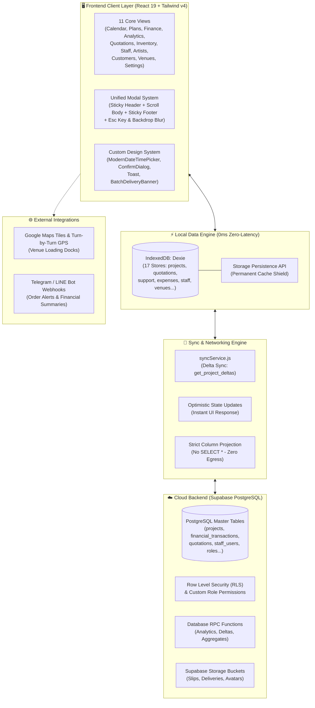
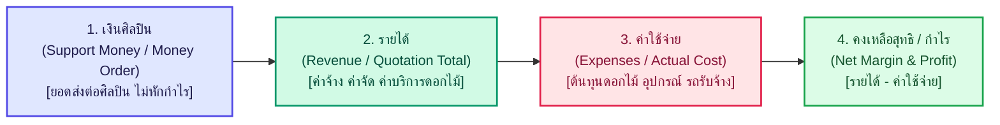
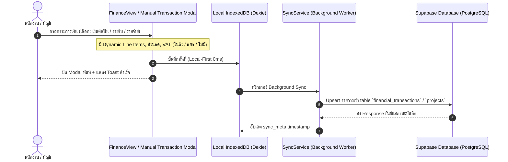
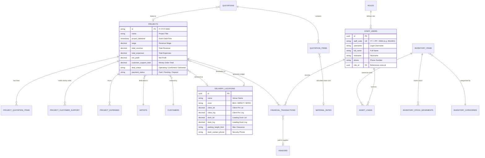
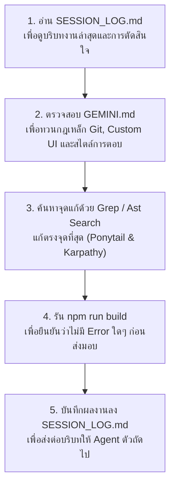

# 🌸 Flower2U - Master System Architecture & Agent Onboarding Roadmap
> **แผนแม่บทสถาปัตยกรรมระบบ ผังการทำงาน และคู่มือส่งต่องานสำหรับ AI Agent & ทีมพัฒนา**
> **สถานะระบบปัจจุบัน**: Production-Ready (React 19 + Vite 7 + Tailwind CSS v4 + Dexie IndexedDB + Supabase)
> **เอกสารคู่ขนาน**: [`.agents/memory/SESSION_LOG.md`](file:///D:/WebappDreame/Flower2U/.agents/memory/SESSION_LOG.md) | [`GEMINI.md`](file:///D:/WebappDreame/Flower2U/GEMINI.md) | [`F2U_DATABASE_SCHEMA_AND_EXPANSION_PLAN.md`](file:///D:/WebappDreame/Flower2U/F2U_DATABASE_SCHEMA_AND_EXPANSION_PLAN.md)

---

## 📑 สารบัญ (Table of Contents)
1. [ภาพรวมระบบและยุทธศาสตร์หลัก (System Snapshot & Core Strategy)](#1-ภาพรวมระบบและยุทธศาสตร์หลัก)
2. [ไดอะแกรมสถาปัตยกรรมระบบรวม (High-Level Architecture Diagram)](#2-ไดอะแกรมสถาปัตยกรรมระบบรวม)
3. [ไดอะแกรมกระแสข้อมูลและการเงิน 4 ขั้นตอน (Financial Data Flow Diagram)](#3-ไดอะแกรมกระแสข้อมูลและการเงิน-4-ขั้นตอน)
4. [ผังความสัมพันธ์ฐานข้อมูล (Unified Entity-Relationship Diagram)](#4-ผังความสัมพันธ์ฐานข้อมูล)
5. [สารบัญโมดูลระบบ 11 วิวหลัก (11 Core Application Views)](#5-สารบัญโมดูลระบบ-11-วิวหลัก)
6. [กฎเหล็กและข้อห้ามเด็ดขาดสำหรับ Agent (Non-Negotiable Directives)](#6-กฎเหล็กและข้อห้ามเด็ดขาดสำหรับ-agent)
7. [แผนที่การพัฒนาและสถานะงาน (Master Roadmap & Milestones Matrix)](#7-แผนที่การพัฒนาและสถานะงาน)
8. [คู่มือเริ่มงานทันทีสำหรับ Agent ตัวถัดไป (Agent Onboarding Quickstart)](#8-คู่มือเริ่มงานทันทีสำหรับ-agent-ตัวถัดไป)

---

## 1. ภาพรวมระบบและยุทธศาสตร์หลัก

**Flower2U (Flower2you)** คือแพลตฟอร์มบริหารจัดการร้านจัดดอกไม้และอีเวนต์ศิลปิน (Fandom Support & Event Florist Operations Platform) ที่ออกแบบมาเพื่อตอบโจทย์งานจัดดอกไม้คอนเสิร์ต งานแฟนมีตติ้ง และซุ้มดอกไม้เงินสด ซึ่งมีความซับซ้อนทางการเงินและการจัดส่งมากกว่าร้านดอกไม้ทั่วไป

### 3 เสาหลักเชิงสถาปัตยกรรม (Core Architectural Pillars):
1. **Local-First & Zero-Latency UI**: ข้อมูลทุกส่วนถูกแคชและบันทึกลง **IndexedDB (`Dexie`)** ประจำเครื่องผู้ใช้ทันที (0ms latency) ไม่ต้องรอเซิร์ฟเวอร์ตอบกลับ ทำให้แอปเร็ว ลื่นไหล และทำงานได้แม้ไม่มีเน็ต
2. **Zero-Egress Strategy**: การดึงข้อมูลจาก Supabase ใช้การกำหนดคอลัมน์เฉพาะเจาะจง (**Strict Column Projections**) และซิงก์เฉพาะข้อมูลที่มีการเปลี่ยนแปลงย้อนหลังผ่าน RPC Function `get_project_deltas()` เพื่อประหยัด Bandwidth และ Egress Cost บนคลาวด์ 100%
3. **Strict Custom UI Standard**: ห้ามใช้ Native Dialogs ของเบราว์เซอร์ (`alert`, `confirm`, `prompt`) และห้ามใช้ Native Date Pickers โดยเด็ดขาด ใช้เฉพาะคอมโพเนนต์ Custom Design System สากล

---

## 2. ไดอะแกรมสถาปัตยกรรมระบบรวม

แผนผังสถาปัตยกรรมแสดงการทำงานตั้งแต่หน้าจอ UI จนถึง Cloud Backend:

---

## 3. ไดอะแกรมกระแสข้อมูลและการเงิน 4 ขั้นตอน

ระบบการเงินของร้าน Flower2U มีโครงสร้างพิเศษที่ต้องปฏิบัติตาม **"กฎลำดับการเงิน 4 ขั้นตอน (Standard 4-Step Financial Sequence)"** อย่างเคร่งครัดในทุกหน้าจอ:

### การไหลของธุรกรรม (Transaction Processing Pipeline):

---

## 4. ผังความสัมพันธ์ฐานข้อมูล

ฐานข้อมูล PostgreSQL บน Supabase และ Local IndexedDB จัดโครงสร้างตามโดเมนธุรกิจ ดังนี้:

---

## 5. สารบัญโมดูลระบบ 11 วิวหลัก

โครงสร้างไฟล์และหน้าที่รับผิดชอบของทั้ง 11 โมดูลใน [`src/`](file:///D:/WebappDreame/Flower2U/src):

| ลำดับ | คอมโพเนนต์หลัก | เส้นทางไฟล์ | หน้าที่และฟังก์ชันสำคัญ |
| :---: | :--- | :--- | :--- |
| 1 | **CalendarView** | [`src/CalendarView.jsx`](file:///D:/WebappDreame/Flower2U/src/CalendarView.jsx) | ปฏิทินแสดงคิวงานและอีเวนต์ ไทม์ไลน์รายเดือน/สัปดาห์/วัน แสดงสถานะงานแบบสี |
| 2 | **PlansView** | [`src/PlansView.jsx`](file:///D:/WebappDreame/Flower2U/src/PlansView.jsx) | แผนงานรายวัน, Kanban Board, เรดาร์ตรวจจับงานส่งพ่วง ([`BatchDeliveryBanner`](file:///D:/WebappDreame/Flower2U/src/components/common/BatchDeliveryBanner.jsx)) |
| 3 | **FinanceView** | [`src/FinanceView.jsx`](file:///D:/WebappDreame/Flower2U/src/FinanceView.jsx) | บัญชีรายรับ-รายจ่าย 8 คอลัมน์มาตรฐาน, ป้ายกำกับศิลปินอยู่บนลูกค้า, ตารางสลิปโอนเงิน, ระบบส่งออก CSV ตามลำดับการเงินสากล |
| 4 | **AnalyticsView** | [`src/AnalyticsView.jsx`](file:///D:/WebappDreame/Flower2U/src/AnalyticsView.jsx) | วิเคราะห์กำไรขาดทุน, **Banknote Float Calculator (แจกแจงธนบัตร ฿1000-฿20)**, Top 10 ทำเลส่งยอดฮิต, Low Margin Anomaly Radar |
| 5 | **QuotationsView** | [`src/QuotationsView.jsx`](file:///D:/WebappDreame/Flower2U/src/QuotationsView.jsx) | คำนวณ Backdrop (กว้าง x ยาว x ตร.ม.), Master Price & Override ตร.ม., พรีเซ็ตด่วน, ค้นหาโปรเจกต์ผูกย้อนหลัง, Clone QT-YYYY-NNN |
| 6 | **InventoryView** | [`src/InventoryView.jsx`](file:///D:/WebappDreame/Flower2U/src/InventoryView.jsx) | สต็อกอุปกรณ์ โครง Truss ดอกไม้สด/แห้ง, ระบบยืม-คืนเครื่องมือช่าง, คลังย่อย และ Checklist ตรวจเช็กของคืน |
| 7 | **StaffView** | [`src/StaffView.jsx`](file:///D:/WebappDreame/Flower2U/src/StaffView.jsx) | บริหารทีมงาน, รหัสพนักงานมาตรฐาน 7 หลัก (`YY`+`PP`+`NNN`), ฟิลเตอร์ Interactive KPI Cards, ประวัติพนักงาน |
| 8 | **ArtistsView** | [`src/ArtistsView.jsx`](file:///D:/WebappDreame/Flower2U/src/ArtistsView.jsx) | ทำเนียบและประวัติศิลปิน, Fandom Name, วันเกิด/วันเดบิวต์, โทนสีประจำตัว, โซเชียลมีเดีย, สถิติเงินซัพพอร์ตสะสม |
| 9 | **CustomersView** | [`src/CustomersView.jsx`](file:///D:/WebappDreame/Flower2U/src/CustomersView.jsx) | ทำเนียบบ้านเบสและลูกค้า, ประวัติการสั่งซื้อ, ช่องทางติดต่อ, สถานะลูกค้าประจำ |
| 10 | **VenuesView** | [`src/VenuesView.jsx`](file:///D:/WebappDreame/Flower2U/src/VenuesView.jsx) | Logistics Map แผนที่พิกัด 2 จุด (จุดส่งลูกค้า vs จุดโหลดของจริง Loading Dock), ส่วนสูงรถ, เบอร์โทร รปภ., เส้นทาง Polyline |
| 11 | **SettingsView** | [`src/SettingsView.jsx`](file:///D:/WebappDreame/Flower2U/src/SettingsView.jsx) | Dynamic Roles & Permissions Matrix, เพิ่ม/ลบบทบาทอิสระ, กำหนดหน้าที่มองเห็น, ซิงก์สถานะระบบ |

---

## 6. กฎเหล็กและข้อห้ามเด็ดขาดสำหรับ Agent

> [!CAUTION]
> **Agent ทุกตัวที่เข้ามารับช่วงต่อ "ต้องปฏิบัติตามกฎ 7 ข้อนี้ 100% โดยไม่มีข้อยกเว้น"**:

### 🚫 กฎข้อที่ 1: ห้ามสั่ง Git Add / Commit / Push เด็ดขาด
- **ผู้ใช้จะเป็นคน Manual Staging, Commit และ Push ขึ้น Production ด้วยตนเองเสมอ**
- อนุญาตให้รันเฉพาะ Read-only Git Commands เช่น `git status`, `git diff`, `git log`

### 🚫 กฎข้อที่ 2: ห้ามใช้ Native Browser Dialogs & Date Pickers เด็ดขาด (Directive 11)
- **ห้ามเด็ดขาด**: `window.alert()`, `window.confirm()`, `window.prompt()`, `<input type="date">`, `<input type="datetime-local">`
- **ปฏิทินเลือกวัน/เวลา**: ต้องใช้ [`<ModernDateTimePicker />`](file:///D:/WebappDreame/Flower2U/src/components/common/ModernDateTimePicker.jsx) เท่านั้น (รองรับ พ.ศ., เวลา, เลือกแค่วันที่ผ่าน `hasTime={false}`)
- **การยืนยันการทำรายการ**: ต้องใช้ [`<ConfirmDialog />`](file:///D:/WebappDreame/Flower2U/src/components/common/ConfirmDialog.jsx) หรือ Custom Backdrop Blur Modal
- **การแจ้งเตือน**: ต้องใช้ [`<Toast />`](file:///D:/WebappDreame/Flower2U/src/components/common/Toast.jsx)

### 📌 กฎข้อที่ 3: ยึดมั่นกฎลำดับการเงิน 4 ขั้นตอน (Standard Financial Hierarchy)
- ในทุกการ์ดสรุป, ตาราง, บัตรงาน, Modal และ CSV Export ต้องเรียงลำดับ:
  1. **เงินศิลปิน (Support Money)** ➔ 2. **รายได้ (Revenue)** ➔ 3. **ค่าใช้จ่าย (Expenses)** ➔ 4. **กำไรสุทธิ (Net Margin)**

### 🎨 กฎข้อที่ 4: การป้องกันบั๊กเส้นสีดำบนตาราง (Table Black Line Glitch Prevention)
- ใน [`src/index.css`](file:///D:/WebappDreame/Flower2U/src/index.css) มีการกำหนด `border-color: #f1f5f9` (Slate-100) ทับ `currentColor` เริ่มต้นของ Tailwind v4
- **ห้ามใส่ `transition-all` หรือสั่ง `transition-colors` ลงบน `table`, `tr`, `th`, `td`** ที่ไปกระทบ `border-color` เพราะจะทำให้ Chromium เรนเดอร์เส้นสีดำกะพริบขณะโหลดแถว

### 💾 กฎข้อที่ 5: Local-First & Zero-Egress Philosophy
- ตรวจสอบและดึงข้อมูลจาก `db.js` (IndexedDB) ก่อนเสมอ
- เวลาติดต่อ Supabase **ห้ามยิง `SELECT *` เด็ดขาด** ให้ระบุเฉพาะคอลัมน์ที่ต้องใช้จริงจาก `PROJECT_LIST_COLUMNS` หรือ Projection Constants ใน [`src/services/syncService.js`](file:///D:/WebappDreame/Flower2U/src/services/syncService.js)

### 🪟 กฎข้อที่ 6: มาตรฐานโครงสร้าง Modal (Silky-Smooth Modal Architecture)
- ทุก Modal ต้องประกอบด้วย 3 ส่วน:
  - **Sticky Header**: ส่วนหัวติดหนึบ พร้อมไอคอน ชื่อเรื่อง คำอธิบาย และปุ่ม `X`
  - **Scrollable Body**: `
`
  - **Sticky Footer**: แถบปุ่ม Action (บันทึก/ยกเลิก) ลอยติดหนึบด้านล่างเสมอ
  - **Keyboard & Backdrop**: ต้องรองรับการกด `Escape` เพื่อปิด และคลิก Backdrop Blur เพื่อปิด

### 🧪 กฎข้อที่ 7: Pre-Delivery Verification Loop
- ก่อนส่งมอบงาน ต้องรัน `npm run build` ตรวจสอบว่าคอมไพล์ผ่าน 100% ปราศจาก Syntax/Type Error
- ตรวจสอบผลลัพธ์ผ่าน `chrome-devtools` (MCP) ทั้ง 3 ขนาดจอ: Mobile (390px), Tablet (820px), Desktop (1440px)
- อัปเดตบันทึกสิ่งที่ทำลงใน [`.agents/memory/SESSION_LOG.md`](file:///D:/WebappDreame/Flower2U/.agents/memory/SESSION_LOG.md) เสมอ

---

## 7. แผนที่การพัฒนาและสถานะงาน

```mermaid
flowchart TD
    subgraph Phase1["✅ Phase 1: ฐานข้อมูล & ย้ายระบบ (100% Complete)"]
        P1_1["สร้าง Supabase Schema 9 โดเมน"]
        P1_2["สคริปต์ดูด 300 แถวจาก Google Sheets"]
        P1_3["ตั้งค่า Dexie IndexedDB v1-v5 (Zero-Egress)"]
    end

    subgraph Phase2["✅ Phase 2: โมดูลหลัก & การปฏิบัติงาน (100% Complete)"]
        P2_1["FinanceView: ตารางบัญชี 8 คอลัมน์ + Manual Tx Modal"]
        P2_2["QuotationsView: Backdrop m² + Master Rates + Clone"]
        P2_3["VenuesView: Logistics Map Dual-Pin + Loading Dock"]
        P2_4["StaffView: Staff Code YY+PP+NNN + Dynamic RBAC Matrix"]
        P2_5["ArtistsView & CustomersView: แฟนด้อมและประวัติ"]
    end

    subgraph Phase3["✅ Phase 3: การวิเคราะห์และการจัดส่ง (100% Complete)"]
        P3_1["AnalyticsView: Banknote Float Calculator"]
        P3_2["BatchDeliveryBanner: เรดาร์ส่งพ่วงเที่ยวเดียว"]
        P3_3["Modal Silky-Smooth Architecture ทั่วทั้งระบบ"]
        P3_4["Eliminate Table Black Line Glitch 100%"]
    end

    subgraph Phase4["🚀 Phase 4: ออโตเมชันข้ามระบบ (Next Milestones)"]
        P4_1["ท่อส่งข้อมูล: บันทึกรายจ่าย ➔ ตัด/บวก สต็อกคลังพัสดุอัตโนมัติ"]
        P4_2["วงจรนำวัสดุกลับมาใช้ซ้ำ (ดอกไม้พลาสติก/โฟม/โครง Truss)"]
        P4_3["Vendor Intelligence: เปรียบเทียบราคาซัพพลายเออร์"]
        P4_4["Realtime Supabase Channel Subscriptions (Multi-Device Live Sync)"]
    end

    subgraph Phase5["🔮 Phase 5: พอร์ทัลลูกค้า & PWA Offline (Future Vision)"]
        P5_1["Customer Portal: ลิงก์ติดตามสถานะงานดอกไม้และสลิปโอน"]
        P5_2["Progressive Web App (PWA): Service Worker Offline Mode"]
        P5_3["AI Image Recognition: ตรวจนับธนบัตรจากภาพถ่ายสลิป/ซุ้ม"]
    end

    Phase1 --> Phase2
    Phase2 --> Phase3
    Phase3 --> Phase4
    Phase4 --> Phase5
```

### รายละเอียดงานสำหรับ Phase 4 (ลำดับงานที่ Agent ถัดไปสามารถทำต่อได้ทันที):

| รายการงาน (Task) | รายละเอียดทางเทคนิค | ไฟล์ที่เกี่ยวข้อง | สถานะ |
| :--- | :--- | :--- | :---: |
| **4.1 ท่อส่งข้อมูล: Expense-to-Inventory** | ใน Manual Transaction Modal หน้า FinanceView เมื่อบันทึกรายจ่ายประเภทอุปกรณ์/วัสดุ ให้มี Checkbox "นำเข้าคลังพัสดุ" แล้วสร้าง `inventory_items` หรือบวก `quantity` ใน `inventory_stock_movements` อัตโนมัติ | [`src/FinanceView.jsx`](file:///D:/WebappDreame/Flower2U/src/FinanceView.jsx), [`src/services/syncService.js`](file:///D:/WebappDreame/Flower2U/src/services/syncService.js) | ⏳ รอพัฒนา |
| **4.2 วงจรดอกไม้นำกลับมาใช้ซ้ำ (Salvage Flow)** | เมื่อโปรเจกต์สถานะเปลี่ยนเป็น "จัดส่งแล้ว/รื้อถอน" ให้มีฟังก์ชัน Salvage Checklist ให้ช่างเลือกจำนวนดอกไม้ปลอม/โฟมบอร์ดที่นำกลับมาใช้ใหม่ได้เพื่อคืนสต็อก | [`src/InventoryView.jsx`](file:///D:/WebappDreame/Flower2U/src/InventoryView.jsx), [`database_scripts/create_inventory_checklist_and_units.sql`](file:///D:/WebappDreame/Flower2U/database_scripts/create_inventory_checklist_and_units.sql) | ⏳ โครงสร้าง DB พร้อมแล้ว |
| **4.3 Vendor Intelligence & Defect Shield** | ระบบวิเคราะห์ประวัติการสั่งซื้อจากซัพพลายเออร์แต่ละเจ้า แจ้งเตือนหากราคาต่อหน่วยแพงกว่าค่าเฉลี่ยในอดีต | [`src/QuotationsView.jsx`](file:///D:/WebappDreame/Flower2U/src/QuotationsView.jsx), [`src/AnalyticsView.jsx`](file:///D:/WebappDreame/Flower2U/src/AnalyticsView.jsx) | ⏳ วางแผนไว้ในสคีมา |
| **4.4 Multi-Device Realtime Subscriptions** | เชื่อมต่อ Supabase Realtime Channels (`supabase.channel('public:*')`) เพื่อให้เครื่องของช่างหน้างานและแอดมินอัปเดตข้อมูลตรงกันแบบ Real-time โดยไม่ต้องกดรีเฟรช | [`src/services/syncService.js`](file:///D:/WebappDreame/Flower2U/src/services/syncService.js), [`src/App.jsx`](file:///D:/WebappDreame/Flower2U/src/App.jsx) | ⏳ รอพัฒนา |

---

## 8. คู่มือเริ่มงานทันทีสำหรับ Agent ตัวถัดไป

เมื่อคุณเป็น AI Agent ตัวใหม่ที่เพิ่งถูกเปิดเข้ามาในโปรเจกต์นี้ ให้ปฏิบัติตาม **5 ขั้นตอนเริ่มต้น (Fast Onboarding Routine)** ดังนี้:

### เช็กลิสต์ด่วนก่อนแก้โค้ด:
- [ ] ฉันไม่ได้สั่ง `git add`, `git commit` หรือ `git push` ใช่หรือไม่?
- [ ] ฉันไม่ได้ใช้ `window.alert`, `window.confirm` หรือ `<input type="date">` ใช่หรือไม่?
- [ ] ตัวเลขและแถบสรุปการเงินเรียงลำดับ: เงินศิลปิน ➔ รายได้ ➔ ค่าใช้จ่าย ➔ กำไรสุทธิ แล้วใช่หรือไม่?
- [ ] ตารางไม่มีการใส่ `transition-colors` หรือขอบสีดำ ใช่หรือไม่?
- [ ] ฉันได้รัน `npm run build` ผ่าน 100% แล้วใช่หรือไม่?

---
*เอกสารฉบับนี้อัปเดตล่าสุด: พฤศจิกายน 2026 โดย Antigravity Senior Pair Programmer*
