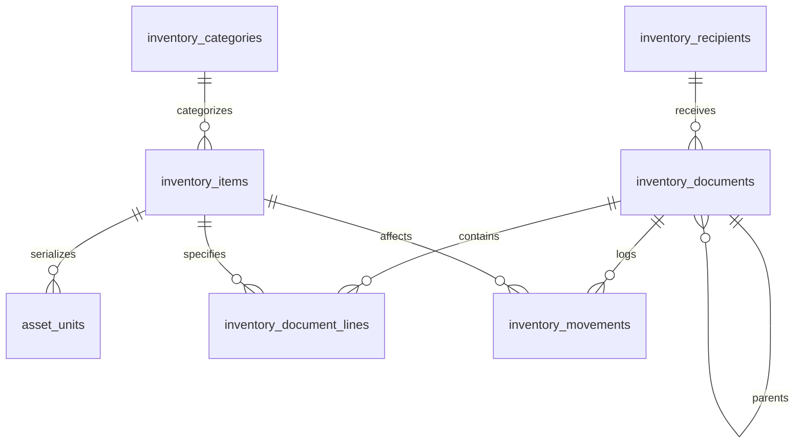

# Flower2you Inventory: Compact Architecture Review

**Author**: Gemini Architecture Reviewer (under Codex)  
**Status**: Architecture Recommendation (Read-Only Review, Ready for Root Decision)  
**Target Constraint**: Free Supabase tier (5 GB monthly uncacheable egress), zero enterprise bloat, preserve executed data.

---

## 1. Executive Summary & Assessment (7 vs 8 Tables)

The two scripts define 22 new tables, and the repository defines 7 legacy inventory tables. This is a static source inventory, not a live database count. The design separates more entities than this application needs; table count itself does not consume egress or increase connection pooling usage. The authoritative implementation decision is in inventory-compact-contract.md and selects 8 physical tables.

**Assessment (7 vs 8 Tables)**:
- **7-Table Core Baseline (Recommended)**: Consolidates all operational forms, receipts, rounds, cash batches, and production stages into a polymorphic **Document + Lines + Ledger** pattern. Meets all business requirements with zero data loss.
- **Is 8 Justified?**: **Yes, exactly one optional 8th table is justified: `cash_vault_denominations`**.
  - *Tradeoff*: Keeping cash denominations in the catalog requires every catalog cache path to exclude them. A separate five-row vault makes that separation easier to maintain. Its reads still consume egress, and related cash documents and events still need correct RLS.
  - *Recommendation*: **7 tables if strict RLS views/filters apply; 8 tables if banking-grade physical cash isolation is prioritized**.

---

## 2. Target Physical Schema (7 Core Tables)



1. **`inventory_categories`**: `id UUID PK`, `name TEXT`, `type TEXT CHECK (type IN ('asset','consumable','reusable','reusable_material'))`, `is_active BOOL`.
2. **`inventory_items`**: `id UUID PK`, `code TEXT UNIQUE`, `name TEXT`, `category_id UUID FK`, `item_type TEXT`, `unit TEXT`, `current_stock NUMERIC(12,2)`, `reserved_stock NUMERIC(12,2) DEFAULT 0`, `min_alert_threshold NUMERIC(12,2)`, `average_cost NUMERIC(12,2)`, `metadata JSONB DEFAULT '{}'`. *(Banknotes THB 20, 50, 100, 500, 1000 stored here unless Table 8 selected)*.
3. **`asset_units`**: `unit_code TEXT PK`, `item_id UUID FK RESTRICT`, `status TEXT CHECK (status IN ('AVAILABLE','BORROWED','BROKEN','LOST'))`, `active_recipient_id UUID FK SET NULL`, `active_document_id UUID FK SET NULL`, `borrowed_at TIMESTAMPTZ`, `due_date TIMESTAMPTZ`, `notes TEXT`.
4. **`inventory_recipients`**: `id UUID PK`, `name TEXT`, `recipient_type TEXT CHECK (recipient_type IN ('individual','team','casual_helper','staff'))`, `staff_user_id TEXT UNIQUE`, `primary_receiver_name TEXT`, `member_names TEXT[] DEFAULT '{}'`, `contact_info TEXT`, `is_active BOOL`.
5. **`inventory_documents`**: `id UUID PK`, `doc_number TEXT UNIQUE`, `doc_type TEXT NOT NULL CHECK (doc_type IN ('PRODUCTION_ISSUE','FIELD_ROUND','RETURN_UNUSED','RECOVERY','ASSIGNMENT','SUBMISSION','INSPECTION','CASH_BATCH','CASH_RESERVATION','CASH_PREPARED','INCIDENT','DISPOSAL','PROCUREMENT','ADJUSTMENT','CHECKLIST'))`, `project_id TEXT FK RESTRICT`, `parent_document_id UUID FK(inventory_documents)`, `recipient_id UUID FK SET NULL`, `recipient_name_snapshot TEXT`, `team_members_snapshot TEXT[]`, `status TEXT NOT NULL`, `due_at TIMESTAMPTZ`, `notes TEXT`, `idempotency_key UUID UNIQUE`, `idempotency_payload_hash TEXT`, `response_payload JSONB`, `actor_auth_user_id UUID`, `actor_name_snapshot TEXT`, `created_at TIMESTAMPTZ DEFAULT now()`.
6. **`inventory_document_lines`**: `id UUID PK`, `document_id UUID FK CASCADE`, `source_line_id UUID FK(inventory_document_lines)`, `line_type TEXT NOT NULL CHECK (line_type IN ('ITEM','WORK_DELIVERABLE','ROUND_PROJECT','INCIDENT_DETAIL'))`, `item_id UUID FK RESTRICT`, `unit_code TEXT FK(asset_units)`, `denomination INT`, `project_id TEXT FK RESTRICT`, `description TEXT`, `required_qty NUMERIC(12,2) DEFAULT 0`, `quantity NUMERIC(12,2) DEFAULT 0`, `submitted_qty NUMERIC(12,2) DEFAULT 0`, `accepted_qty NUMERIC(12,2) DEFAULT 0`, `rejected_qty NUMERIC(12,2) DEFAULT 0`, `pending_qty NUMERIC(12,2) GENERATED ALWAYS AS (quantity - accepted_qty - rejected_qty) STORED`, `unit TEXT DEFAULT 'ชิ้น'`, `notes TEXT`, `CONSTRAINT chk_qty_limits CHECK (accepted_qty + rejected_qty <= quantity)`.
7. **`inventory_movements`**: `id UUID PK`, `document_id UUID FK SET NULL`, `line_id UUID FK SET NULL`, `item_id UUID FK RESTRICT`, `unit_code TEXT`, `movement_type TEXT NOT NULL`, `delta_stock NUMERIC(12,2) NOT NULL DEFAULT 0`, `denomination INT`, `note_count INT DEFAULT 0`, `total_value NUMERIC(12,2) GENERATED ALWAYS AS (COALESCE(denomination * note_count, 0)) STORED`, `from_location TEXT`, `to_location TEXT`, `actor_auth_user_id UUID`, `actor_name_snapshot TEXT`, `details JSONB DEFAULT '{}'`, `created_at TIMESTAMPTZ DEFAULT now()`.

---

## 3. Complete Source-to-Target Migration Matrix

| # | Existing Source Table (Plan C / Hub / Legacy) | Target Compact Table | Target Discriminator / Storage Column | Preservation & Foreign Key Integrity |
|---|---|---|---|---|
| 1 | `inventory_recipients` | `inventory_recipients` | 1:1 Identity | Preserves `id UUID`, `staff_user_id` |
| 2 | `inventory_recipient_teams` | `inventory_recipients` | `recipient_type = 'team'` | Fold `member_names`, `primary_receiver_name` |
| 3 | `inventory_field_rounds` | `inventory_documents` | `doc_type = 'FIELD_ROUND'` | Preserves `round_code` -> `doc_number` |
| 4 | `inventory_field_round_projects` | `inventory_document_lines` | `line_type = 'ROUND_PROJECT'` | `project_id` ON DELETE RESTRICT |
| 5 | `inventory_documents` | `inventory_documents` | 1:1 Identity | Preserves all UUIDs, `idempotency_key` |
| 6 | `inventory_movements` | `inventory_movements` | 1:1 Identity | Preserves stock audit and UUIDs |
| 7 | `inventory_material_recoveries` | `inventory_documents` + `lines` | `doc_type = 'RECOVERY'` | `source_line_id` preserves recovery provenance |
| 8 | `asset_unit_custody` | `asset_units` + `inventory_movements` | Active custody cols on unit | Active state in `asset_units`; log in movements |
| 9 | `inventory_incidents` | `inventory_documents` + `lines` | `doc_type = 'INCIDENT'` | Linked to `unit_code` and `project_id` |
| 10 | `cash_vault_denominations` | `inventory_items` *(or Table 8)* | `item_type = 'banknote'` | `current_stock` = physical count |
| 11 | `cash_job_reservations` | `inventory_documents` + `lines` | `doc_type = 'CASH_RESERVATION'` | `project_id` ON DELETE RESTRICT |
| 12 | `cash_helper_batches` | `inventory_documents` + `lines` | `doc_type = 'CASH_BATCH'` | Preserves `batch_code`, counts in lines |
| 13 | `cash_prepared_sets` | `inventory_documents` + `lines` | `doc_type = 'CASH_PREPARED'` | Denomination and counts in lines |
| 14 | `cash_movements` | `inventory_movements` | `movement_type = 'CASH_*'` | Denomination, note count, total value |
| 15 | `inventory_idempotency_records` | `inventory_documents` | Native header fields | `idempotency_key`, `payload_hash`, `response_payload` |
| 16 | `production_assignments` | `inventory_documents` | `doc_type = 'ASSIGNMENT'` | Preserves task lifecycle and UUID |
| 17 | `production_assignment_lines` | `inventory_document_lines` | `line_type = 'WORK_DELIVERABLE'` | Required, submitted, accepted, rejected qtys |
| 18 | `production_submissions` | `inventory_documents` | `doc_type = 'SUBMISSION'` | `parent_document_id` -> assignment |
| 19 | `production_submission_lines` | `inventory_document_lines` | `line_type = 'SUBMISSION_LINE'` | `source_line_id` -> assignment line |
| 20 | `production_inspections` | `inventory_documents` | `doc_type = 'INSPECTION'` | `parent_document_id` -> submission |
| 21 | `production_inspection_lines` | `inventory_document_lines` | `line_type = 'INSPECTION_LINE'` | Inspection decisions and accepted qtys |
| 22 | `production_assignment_events` | `inventory_movements` | `movement_type = 'ASSIGNMENT_EVENT'` | Details JSONB and actor audit |
| 23 | `legacy.asset_loans` | `inventory_documents` + `movements` | `doc_type = 'ASSET_LOAN'` | Map to unit custody + movement log |
| 24 | `legacy.inventory_procurements` | `inventory_documents` + `lines` | `doc_type = 'PROCUREMENT'` | Preserves vendor_id, unit cost, quantities |
| 25 | `legacy.inventory_disposals` | `inventory_documents` + `lines` | `doc_type = 'DISPOSAL'` | Preserves disposal code, financial loss |
| 26 | `legacy.project_checklist_items` | `inventory_document_lines` | `line_type = 'CHECKLIST'` | Preserves checklist BOM requirements |

---

## 4. Integrity, Locking & RLS Enforcement

1. **Strict Cash RLS**:
   - Policed via PostgreSQL RLS on `inventory_documents`, `inventory_document_lines`, and `inventory_movements`:
   ```sql
   USING (
     (doc_type NOT LIKE 'CASH_%' AND public.fn_can_access_inventory(auth.uid()))
     OR (doc_type LIKE 'CASH_%' AND public.fn_can_manage_cash(auth.uid()))
     OR public.fn_is_admin(auth.uid())
   );
   ```
2. **Row Locks & Idempotency**:
   - `inventory_documents(idempotency_key)` UNIQUE constraint prevents duplicate execution at the engine level.
   - Banknote / stock mutations execute `SELECT current_stock FROM public.inventory_items WHERE id = p_item_id FOR UPDATE;` to serialize concurrent requests.
3. **Tool Serialized Uniqueness**:
   - `asset_units(unit_code)` is strictly unique. Status transition from `AVAILABLE` to `BORROWED` requires `WHERE status = 'AVAILABLE'`, preventing double-assignment.
4. **Output Submitted vs Accepted Math**:
   - Stored generated column `pending_qty` and `CHECK (accepted_qty + rejected_qty <= quantity)` in `inventory_document_lines` mathematically prevent over-inspection.
5. **Flower Recovery Lineage**:
   - Recovery lines retain `source_line_id` pointing directly to the original issue deliverable line, maintaining the full lifecycle: `ISSUE -> RECOVERY -> INSPECTION`.

---

## 5. RPC Facade & 1-Transaction Safe Migration

The public write RPC signatures can remain compatible while their SQL implementations change. Frontend changes are required for pagination, lazy unit loading, legacy checklist writes, direct reads of removed tables, and realtime subscriptions. Compatibility must be verified with behavior tests, not assumed from RPC names.

### Safe Migration Protocol:
1. **Copy Phase**: In a single transaction, copy data from the 22 tables + 4 legacy tables into target tables.
2. **Validation Assertion**:
   ```sql
   DO $$
   BEGIN
     ASSERT (SELECT count(*) FROM public.inventory_documents) >= (SELECT count(*) FROM public._legacy_doc_count), 'Document count mismatch';
     ASSERT (SELECT count(*) FROM public.inventory_movements) >= (SELECT count(*) FROM public._legacy_move_count), 'Movement count mismatch';
   END $$;
   ```
3. **No-Cascade Drop**: Drop legacy/staging tables using explicit `DROP TABLE public.tableName RESTRICT;`. If any unknown external view or trigger references the table, PostgreSQL immediately aborts the transaction without dropping data.

---

## 6. Tradeoffs & Dependency Risks

1. **Tradeoffs**:
   - *Polymorphic Complexity*: Queries against `inventory_document_lines` filter on `line_type` and `document_id`. Filtered partial indexes (`idx_lines_doc_work`, `idx_lines_doc_item`) maintain index scan performance.
   - *Cash Isolation*: If Table 8 is skipped, banknote items inside `inventory_items` require an RLS policy preventing client Dexie sync from replicating vault quantities to browser IndexedDB.
2. **External Dependency Risks**:
   - `projects(id)` and `vendors(id)` must strictly enforce `ON DELETE RESTRICT` to protect financial auditability.
   - `db.js` Dexie schemas in frontend must not query removed legacy tables directly; all access flows through the existing Supabase RPC suite.
