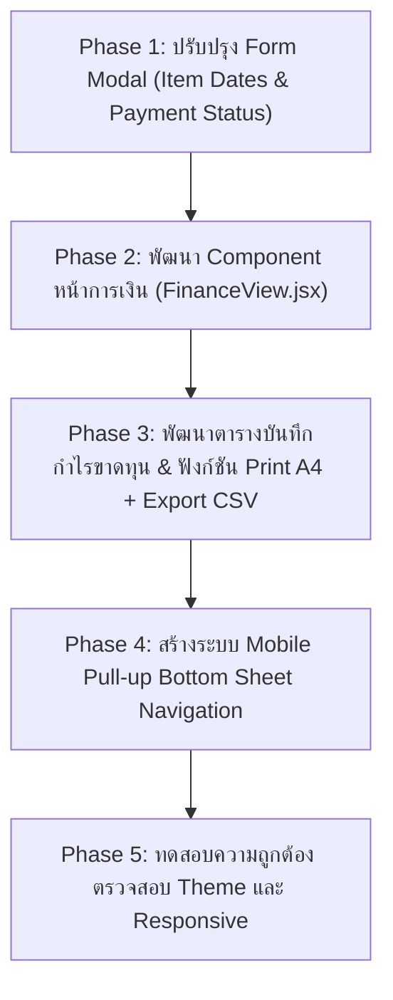

# แผนพัฒนา: ระบบหน้าการเงินและตารางบันทึกกำไรขาดทุน (Flower2U)

> **เอกสารแผนงานโครงการ (Project Roadmap & Technical Specification)**  
> **เป้าหมาย:** พัฒนาหน้าการเงิน (Finance Management Page), ตารางบันทึกข้อมูลกำไรขาดทุน (Print A4 Ready), วันที่ในรายการบิล/รายจ่าย, ฟิลด์สถานะการเงิน และระบบ Mobile Navigation แบบลากขึ้น (Pull-up Drawer)

---

## 1. ภาพรวมความต้องการ (Requirements Overview)

| ลำดับ | รายการ | รายละเอียดการพัฒนา |
| :--- | :--- | :--- |
| **1** | **ระบบ Mobile Navigation แบบลากขึ้น (Pull-up Drawer)** | ปรับแถบเมนูด้านล่างบนมือถือ (Bottom Nav) ให้มี Drag Handle สำหรับลาก/สไลด์ขึ้นมาเป็น Bottom Sheet เพื่อเลือกเมนูทั้งหมดได้อย่างสะดวก (ภาพรวม, ปฏิทิน, วิเคราะห์, แผนงาน, การเงิน, ตั้งค่า) |
| **2** | **เพิ่มฟิลด์สถานะการเงิน (Payment Status)** | เพิ่มตัวเลือกสถานะการชำระเงินในระบบบันทึกโครงการ (รอชำระเงิน, มัดจำแล้ว, ชำระครบแล้ว, คืนเงิน) พร้อมระบุจำนวนเงินมัดจำ และยอดคงค้าง |
| **3** | **เพิ่มช่องใส่วันที่ในรายการย่อย (Item Date Tracking)** | เพิ่มช่องใส่วันที่ในแต่ละรายการย่อยของโครงการ (วันที่รับเงินสนับสนุน, วันที่ทำบิลเสนอราคา, วันที่จ่ายเงินค่าใช้จ่ายจริง) เพื่อนำไปซิงค์และแสดงผลในตารางกำไรขาดทุน |
| **4** | **หน้าการเงิน (Finance Page)** | แดชบอร์ดสรุปตัวเลขสำคัญทางการเงิน (รายรับรวม, รายจ่ายรวม, ยอดซัพพอร์ต, กำไรสุทธิ, ยอดค้างชำระ) พร้อมกราฟแนวโน้มกระแสเงินสด |
| **5** | **ตารางบันทึกข้อมูลกำไรขาดทุน (Print A4 Ready)** | ตารางรายละเอียดตามรูปแบบภาพตัวอย่าง แสดงแจกแจง 3 หมวดพร้อมวันที่ต่อท้ายแต่ละรายการ พิมพ์ A4 ได้ทันที มีแถวว่างสำหรับจดบันทึก และแถวสรุปรวมท้ายตาราง |
| **6** | **ฟังก์ชันส่งออก Excel & ตัวเลือกการพิมพ์** | ปุ่ม Export เป็น Excel/CSV และสวิตช์เลือกมุมมอง (Interactive vs Accounting Sheet View) พร้อม Checkbox เลือกเปิด/ปิดเส้นบรรทัดว่างก่อนสั่งพิมพ์ |

---

## 2. โครงสร้างตาราง "บันทึกข้อมูลกำไรขาดทุน" (Print A4 Formatter)

อ้างอิงจากโครงสร้างในภาพตัวอย่างล่าสุด ทุกรายการย่อยจะแสดงวันที่กำกับไว้อย่างชัดเจน:

### คอลัมน์ของตาราง (Table Columns)
1. **วันที่ (Date):** วันที่จัดทำ/วันที่หลักของโครงการ (เช่น `13/10/2026`)
2. **รายการ (Project Breakdown พร้อมวันที่ต่อท้าย):**
   * **รหัสโครงการ:** แสดงบนสุด เช่น `P-0021` (พร้อมชื่อโครงการ/ลูกค้า)
   * **1. เงินสนับสนุนศิลปิน (Money Order):** ดึงจาก `customerSupport` พร้อมวันที่รับเงิน
     * `- แบงค์ 1,000 บาท x 10 ใบ = 10,000 บาท - 13/10/2026`
     * `- แบงค์ 500 บาท x 10 ใบ = 5,000 บาท - 13/10/2026`
     * `- แบงค์ 20 บาท x 5 ใบ = 100 บาท - 13/10/2026`
   * **2. รายการเสนอราคา (Quotation):** ดึงจาก `quotationItems` พร้อมวันที่ทำบิล/รับชำระ
     * `- ค่าอุปกรณ์ในการจัดทำ 500,000 บาท - 13/10/2026`
     * `- ค่ารถ 1,200 บาท - 13/10/2026`
     * `- ค่าจ้าง 500 บาท - 13/10/2026`
   * **3. รายจ่ายจริง / ต้นทุนเพิ่ม (Expenses):** ดึงจาก `expenses` พร้อมวันที่จ่ายเงินจริง
     * `- ซื้อโฟมเพิ่ม 1 แผ่น 2,000 บาท - 13/10/2026`
     * `- โฟมที่มีอยู่ในสต็อกนำมาใช้ 1 แผ่น - 13/10/2026`
3. **รายรับ (Revenue):** ยอดรวมเงินทั้งหมดที่ได้รับ (Quotation Items + Support)
4. **เงินสนับสนุนศิลปิน (Artist Support):** ยอดรวมเงินสนับสนุนส่งต่อศิลปิน (หักแยกเพื่อความชัดเจนทางบัญชี)
5. **รายจ่าย (Expenses):** ยอดรวมต้นทุนและค่าใช้จ่ายจริงที่เกิดขึ้น
6. **คงเหลือ (Net Balance / Profit):** กำไรสุทธิของโครงการ (`รายรับ - เงินสนับสนุนศิลปิน - รายจ่าย` หรือ `Quotation - Expenses`)

### คุณสมบัติการพิมพ์ขนาด A4 (A4 Print Ready Specification)
* **หัวกระดาษ:** 
  * ชื่อเอกสารเด่นชัด: **"บันทึกข้อมูลกำไรขาดทุน"**
  * ข้อมูลร้าน: ชื่อร้าน Flower2U, โลโก้, ข้อมูลติดต่อ
  * ช่วงเวลาของรายงาน: เช่น *"ประจำเดือน ตุลาคม 2569"* หรือ *"ระหว่างวันที่ DD/MM/YYYY - DD/MM/YYYY"*
* **การจัดหน้ากระดาษ (Print Layout):**
  * กำหนดการพิมพ์ขนาด **A4 แนวตั้ง (Portrait) เป็นค่าเริ่มต้น (Default)** และสามารถสลับเป็นแนวนอนได้
  * ซ่อนเมนู Navbar, Sidebar, ปุ่มกด และองค์ประกอบเว็บไซต์ทั้งหมด เหลือเฉพาะตารางที่พร้อมพิมพ์
  * เส้นตาราง: **เส้นคั่นแนวนอนระหว่างแต่ละโปรเจคเป็นเส้นประ (Dashed Lines)** ตามแบบสมุดบัญชีจริงในรูปภาพตัวอย่าง โดยเส้นคั่นแนวตั้งระหว่างคอลัมน์และขอบตารางยังคงเป็นเส้นทึบคมชัด (Solid Lines)
  * **เส้นบรรทัดเปล่าสำรอง:** กำหนดค่าเริ่มต้นเป็น **ไม่ติ๊กเลือก (Unchecked)** หากต้องการเขียนเพิ่มเติมด้วยลายมือสามารถติ๊กเลือกเปิดใช้งานได้เอง
* **แถวสรุปรวมท้ายตาราง (Summary Row):**
  * รวมรายรับทั้งหมด
  * รวมเงินสนับสนุนศิลปินทั้งหมด
  * รวมรายจ่ายทั้งหมด
  * รวมยอดคงเหลือสุทธิ (Net Total Profit)

---

## 3. การเพิ่มช่องใส่วันที่ในระดับรายการย่อย (Item Date Tracking)

เพื่อให้ข้อมูลวันที่ในตารางกำไรขาดทุนซิงค์กับข้อมูลต้นทางในระบบได้อย่างสมบูรณ์ จะเพิ่มช่องใส่วันที่ใน Form Modal:

### การปรับปรุงฟอร์มบันทึกโครงการ (Modal)
1. **ในส่วนเงินสนับสนุนศิลปิน (`customerSupport`):**
   * เพิ่มช่อง **"วันที่รับเงิน"** ในแต่ละแถว (Default เป็น**วันที่และเวลาปัจจุบัน** ณ ตอนเพิ่มรายการ เพื่อความแม่นยำในการลงบันทึก)
2. **ในส่วนรายการใบเสนอราคา (`quotationItems`):**
   * เพิ่มช่อง **"วันที่ทำบิล/รับเงิน"** ในแต่ละรายการค่าจ้างหรือค่าอุปกรณ์ (Default เป็น**วันที่และเวลาปัจจุบัน**)
3. **ในส่วนรายจ่ายจริง / ต้นทุนเพิ่ม (`expenses`):**
   * เพิ่มช่อง **"วันที่จ่ายเงิน/ซื้อของ"** ในแต่ละรายการต้นทุน (Default เป็น**วันที่และเวลาปัจจุบัน**)
4. **ระบบ Backward Compatibility (ข้อมูลเก่า):**
   * หากเป็นโครงการเก่าที่ยังไม่ได้ระบุวันที่ระดับรายการย่อย ระบบจะดึง `paymentDate` หรือ `date` ของโครงการมาแสดงผลอัตโนมัติ ไม่เกิดช่องว่างหรือข้อผิดพลาด

---

## 4. ระบบ Mobile Navigation แบบลากขึ้น (Pull-up Bottom Sheet)

เพื่อตอบโจทย์การใช้งานบนมือถือที่เมนูเริ่มมีจำนวนมากขึ้น (6 หน้าหลัก) และให้ความรู้สึกทันสมัย:

### การทำงาน (UX Flow)
1. **สถานะปกติ (Collapsed State):**
   * แถบ Bottom Nav อยู่ด้านล่างสุดของจอ แสดง 4 เมนูยอดนิยม + ปุ่ม (+) ตรงกลางสำหรับเพิ่มงาน
   * ด้านบนสุดของแถบมี **Drag Handle (ขีดจับสีเทาอ่อน)** พร้อมไอคอนลูกศรชี้ขึ้นเล็กๆ เพื่อสื่อสารให้ผู้ใช้รู้ว่าสามารถลากขึ้นได้
2. **สถานะกางออก (Expanded / Pull-up State):**
   * ผู้ใช้สามารถ **ใช้นิ้วปัดลากขึ้น (Swipe/Drag Up)** หรือ **แตะที่แถบ Handle**
   * แถบจะเลื่อนเปิดขึ้นมาเป็น **Bottom Sheet Drawer** (คล้าย Google Maps หรือ Apple Maps)
   * ภายใน Sheet จะแสดง **เมนูครบทุกหน้าแบบเต็มตา (Full Menu Grid)**:
     * 🏠 **ภาพรวมแผนงาน (Overview)**
     * 📅 **ปฏิทินงาน (Calendar)**
     * 📊 **วิเคราะห์ประสิทธิภาพ (Analytics)**
     * 📋 **รายการแผนงาน (Plans)**
     * 💰 **การเงินและบัญชี (Finance)** *(เมนูใหม่)*
     * ⚙️ **ตั้งค่าระบบ (Settings)**
   * ปัดลง (Swipe Down) หรือแตะพื้นที่ว่างเพื่อปิดกลับลงไปตำแหน่งเดิม

---

## 5. การเพิ่มฟิลด์สถานะการเงิน (Payment Status Field)

ขยายข้อมูลโครงการ (Activity Schema) ในระบบ เพื่อให้ติดตามกระแสเงินสดได้แม่นยำ 100%:

### ฟิลด์ที่จะเพิ่มใน Form Modal
1. **สถานะการชำระเงิน (`paymentStatus`):**
   * 🟡 **รอชำระเงิน (Unpaid / Pending)** - ยังไม่ได้รับเงิน
   * 🔵 **ชำระมัดจำแล้ว (Partial / Deposit)** - ได้รับเงินมัดจำบางส่วน
   * 🟢 **ชำระครบถ้วนแล้ว (Paid / Completed)** - รับเงินเต็มจำนวนแล้ว
   * 🔴 **คืนเงิน / ยกเลิก (Refunded / Cancelled)** - มีการคืนเงิน
2. **ยอดเงินมัดจำ (`depositAmount`):** ระบุจำนวนเงินที่รับมัดจำมาแล้ว (กรณีเลือกสถานะมัดจำ)
3. **ยอดคงค้างชำระ (`remainingAmount`):** คำนวณอัตโนมัติ (`ยอดรวม - มัดจำ`)
4. **วันที่ชำระเงินหลัก (`paymentDate`):** บันทึกวันที่ลูกค้ารับชำระเงินจริง

---

## 6. ฟังก์ชันเพิ่มเติมที่ได้รับการอนุมัติ (Enhanced Features)

1. **โหมดสลับมุมมอง (Toggle View Mode):**
   * **มุมมองหน้าจอเว็บ (Interactive Dashboard View):** การ์ด KPI, กราฟกระแสเงินสด, ฟิลเตอร์ค้นหา และตารางแบบย่อ
   * **มุมมองสมุดบัญชี (Accounting Sheet View):** ตารางกำไรขาดทุน 6 คอลัมน์ตรงตามภาพตัวอย่าง พร้อมแจกแจง 3 หมวดและวันที่
2. **ปุ่มส่งออกเป็น Excel (CSV):**
   * ส่งออกข้อมูลตารางกำไรขาดทุนและแจกแจงรายการเป็นไฟล์ `.csv` รองรับภาษาไทย (UTF-8 BOM) เพื่อนำไปเปิดใช้งานต่อใน Microsoft Excel หรือ Google Sheets
3. **ตัวเลือกก่อนสั่งพิมพ์ (Print Customization):**
   * Checkbox เลือกว่าต้องการ *"เพิ่มแถวว่างสำรองสำหรับจดบันทึกด้วยมือ"* หรือ *"พิมพ์เฉพาะรายการที่มีอยู่จริง"*
   * ปุ่มเลือกพิมพ์ขนาด A4 แนวตั้ง (Portrait) หรือ แนวนอน (Landscape)

---

## 7. แผนการดำเนินงานและสถาปัตยกรรมโค้ด (Roadmap & Implementation Steps)

### Phase 1: Form Modal & Data Fields (ปรับปรุงฟอร์มบันทึกงาน)
* เพิ่มช่องใส่วันที่ในรายการย่อย: `customerSupportItems`, `quotationItems`, `expenses`
* เพิ่มฟิลด์ `paymentStatus`, `depositAmount`
* ตั้งค่า Default วันที่ให้อัตโนมัติเป็น**วันที่และเวลาปัจจุบัน** ณ ตอนเพิ่มรายการใหม่ เพื่อความสะดวกรวดเร็วและบันทึกเวลาที่เกิดขึ้นจริง

### Phase 2: พัฒนา `src/FinanceView.jsx` (หน้าการเงินแบบแยกไฟล์)
* แยกเป็นไฟล์ Component อิสระเพื่อความสะอาดของโค้ด ไม่ทำให้ `App.jsx` ที่มี 9,000 บรรทัดทำงานหนักเกินไป
* สร้างการ์ด Financial KPI Cards (รายรับ, รายจ่าย, กำไร, ยอดซัพพอร์ต, เงินมัดจำ, ยอดรอเก็บ)
* กราฟเปรียบเทียบกระแสเงินสดรายเดือน (Cashflow Trends)

### Phase 3: ตารางบันทึกกำไรขาดทุน & ฟังก์ชันพิมพ์ A4 (Print Engine)
* พัฒนาตารางแจกแจง 6 คอลัมน์พร้อมแสดงวันที่ต่อท้ายแต่ละรายการ
* เพิ่มปุ่ม **"พิมพ์รายงาน A4 (Print to A4)"** โดยเปิดแบบฟอร์มในแท็บใหม่ (`window.open`) รองรับการพิมพ์รายงานยาวหลายหน้า (Multi-page Pagination) ไม่ถูกตัดจบแค่หน้าเดียว พร้อมปุ่มสั่งพิมพ์และบันทึก PDF
* เพิ่มปุ่ม **"ส่งออก Excel (CSV)"** รองรับภาษาไทย UTF-8 BOM

### Phase 4: Mobile Pull-up Navigation Bar
* ปรับแต่งโค้ดส่วน `Mobile Bottom Navigation` ใน `App.jsx`
* รองรับ Touch Gesture (TouchStart, TouchMove, TouchEnd) เพื่อลากเปิด/ปิดถาดเมนู
* แสดงไอคอนครบทั้ง 6 หมวดหมู่อย่างสวยงาม ไม่ล้นจอ

### Phase 5: ทดสอบและจัดเก็บเข้าสู่ระบบ
* ตรวจสอบการคำนวณตัวเลขทางคณิตศาสตร์ทั้งหมด (Quotation, Expenses, Support, Profit)
* ทดสอบการพิมพ์จริงผ่านเบราว์เซอร์ (Chrome Print Preview -> Save as PDF / A4)
* ตรวจสอบการใช้งานบนหน้าจอคอมพิวเตอร์ แท็บเล็ต และสมาร์ตโฟน

---

## 8. คำแนะนำเชิงรุกด้านการซิงค์ข้อมูล (Data Sync Guidance)

> [!TIP]
> **การจัดเก็บข้อมูลใน Google Sheets:**  
> ในระบบปัจจุบันของ Flower2U รายการ `customerSupport`, `quotationItems`, และ `expenses` ถูกจัดเก็บเป็น JSON Array อยู่ในเซลล์ของ Google Sheets อยู่แล้ว  
> **ผลดีคือ:** เมื่อเราเพิ่มฟิลด์ `date` ลงในแต่ละรายการย่อย (`{ category, detail, quantity, unitPrice, price, date }`) ข้อมูลวันที่นี้จะถูกบันทึกและส่งไปเก็บที่ Google Sheets ได้ทันที **โดยไม่ต้องแก้ไขหรือเพิ่มคอลัมน์ใหม่ใน Google Sheets** และระบบจะยังคงใช้งานร่วมกับข้อมูลเก่าได้อย่างราบรื่น 100%

> [!NOTE]
> **สำหรับฟิลด์ใหม่ระดับโครงการ (`paymentStatus`, `depositAmount`):**  
> ในเบื้องต้นระบบสามารถบันทึกและอ่านค่าผ่านโครงสร้างข้อมูลได้ทันที หากในอนาคตต้องการแยกเป็นคอลัมน์เฉพาะบนแผ่น Google Sheets เพื่อเปิดดูแยกในชีตได้ง่ายขึ้น ทางทีมพัฒนาจะจัดทำ Script เพิ่มหัวตารางให้อย่างปลอดภัยครับ
