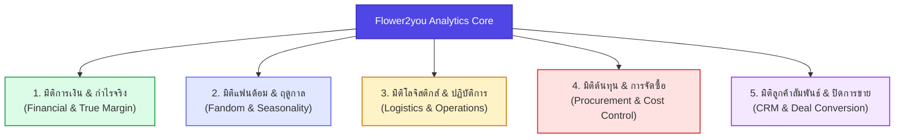
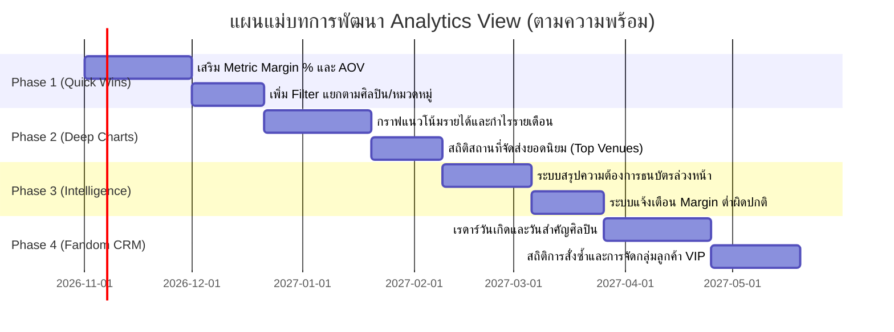

# 📊 แผนพัฒนาระบบวิเคราะห์ข้อมูลและธุรกิจ (Business & Data Analytics Roadmap)
**Flower2you (Flower2U)**  
*เอกสารฉบับนี้จัดทำขึ้นเป็นคู่มือและแผนแม่บทสำหรับพัฒนาหน้า "วิเคราะห์ประสิทธิภาพ" (Analytics View) ในอนาคต*

---

## 🎯 1. บทนำและวิสัยทัศน์ (Executive Summary)

โมเดลธุรกิจของ **Flower2you** มีลักษณะเฉพาะตัวสูง คือเป็นจุดตัดระหว่าง:
1. **งานหัตถศิลป์ & จัดดอกไม้ (Craft & Florist)**
2. **บริการจัดการเงินสดส่งต่อศิลปิน (Money Order & Fandom Support)**
3. **ธุรกิจตามรอบอีเวนต์ & คอนเสิร์ต (Event & Concert Economy)**

เป้าหมายของระบบวิเคราะห์ข้อมูลฉบับนี้ คือการเปลี่ยนข้อมูลที่ถูกบันทึกรายวันในระบบ ให้กลายเป็น **"เข็มทิศนำทางธุรกิจ"** ที่ตอบได้ว่า:
- **อะไรทำแล้วได้กำไรจริง** และอะไรทำแล้วเหนื่อยฟรี
- **แฟนด้อม/ศิลปินคนไหน** มีกำลังซื้อสูงและมีรอบการจัดงานเมื่อไหร่
- **ต้นทุนใดรั่วไหล** และควรตัดสินใจซื้อเครื่องมือเอง (Make or Buy) หรือไม่
- **จุดสะดุดด้านการจัดส่ง** เกิดขึ้นที่ฮอลล์ไหน บ่อยที่สุด

---

## 🗄️ 2. คลังข้อมูลปัจจุบันที่มีอยู่ในระบบ (Current Data Inventory)

ระบบปัจจุบันเก็บข้อมูลในแต่ละโปรเจกต์ไว้อย่างละเอียด ซึ่งพร้อมนำไปคำนวณต่อยอดได้ทันที:

| กลุ่มข้อมูล | ตัวแปร/ฟิลด์ที่บันทึก | ศักยภาพในการนำไปต่อยอดวิเคราะห์ |
| :--- | :--- | :--- |
| **งาน & สินค้า** | `name`, `category` | วิเคราะห์ความนิยมของประเภทสินค้า (ช่อขาตั้ง, ป้าน้อง, ช่อถือ, ช่อธนบัตร) และ Margin รายชิ้น |
| **การเงินฝั่งรายรับ** | `wage`, `quotationItems` | วิเคราะห์มูลค่างานเฉลี่ย (AOV), สัดส่วนค่าบริการ, ค่าอุปกรณ์, ค่าส่งที่คิดจากลูกค้า |
| **เงินสนับสนุนศิลปิน** | `customerSupport` (denomination, quantity, price) | วิเคราะห์ปริมาณเงินสดที่ไหลผ่านมือ, ความต้องการธนบัตรแต่ละชนิด (แบงค์ 1000, 500, 100) |
| **ต้นทุนค่าใช้จ่ายจริง** | `expenses` (category, detail, unitPrice, quantity, date) | วิเคราะห์ต้นทุนแฝงรายหมวดหมู่ (ค่าปริ้น, ค่ารถ, ค่าดอกไม้, ค่าโฟม, ค่ากล่อง) |
| **ไทม์ไลน์ & เวลา** | `date`, `rawDateTime`, `paymentDate`, `deliveryDate` | วิเคราะห์ Lead Time การสั่งงาน, ฤดูกาล (Seasonality), วันที่งานชนกัน |
| **ลูกค้า & ศิลปิน** | `artist`, `customer` | จัดอันดับแฟนด้อมกำลังซื้อสูง, อัตราการกลับมาสั่งซ้ำ (Repeat Rate) |
| **โลจิสติกส์ & ขนส่ง** | `location`, `mapLink`, `recipient`, `recipientPhone`, `transportType`, `transportStatus` | รวมรอบส่ง (Batch Delivery), ฮอลล์ยอดฮิต, อัตราปัญหาการส่งมอบ |
| **สถานะงาน & บิล** | `dealStatus`, `paymentStatus`, `depositAmount`, `slips` | Conversion Rate การปิดดีล, สัดส่วนงานยกเลิก, การจัดการเงินมัดจำ |

---

## 🧭 3. เสาหลัก 5 มิติการวิเคราะห์เชิงลึก (5 Analytical Dimensions)

---

### มิติที่ 1: การเงิน & กำไรที่แท้จริง (Financial & True Profitability)
> *เป้าหมาย: ตรวจดูว่าเงินเข้าจริงเท่าไหร่ และเหลือกำไรสุทธิจากแต่ละประเภทงานกี่ %*

1. **Net Margin แยกตามประเภทงาน (Margin by Category)**
   - ช่อธนบัตร vs ช่อดอกไม้สด vs ช่อดอกไม้ประดิษฐ์ vs ป้าน้อง
   - คำนวณ `% กำไรสุทธิ = (รายได้ - รายจ่ายจริง) / รายได้` ของแต่ละหมวดหมู่งาน เพื่อดันยอดขายหมวดที่ทำกำไรสูงสุด
2. **กระแสเงินสดและปริมาณธนบัตร (Money Order & Float Analysis)**
   - ปริมาณเงินสดรวมที่ไหลผ่านระบบในแต่ละเดือน/ปี
   - สถิติจำนวนใบของธนบัตรแต่ละราคา (เช่น แบงค์ 1,000 ใช้ 2,500 ใบ, แบงค์ 100 ใช้ 18,000 ใบ) สำหรับวางแผนเบิกเงินสดใหม่จากธนาคาร
3. **True Profit per Project (กำไรสุทธิต่องานจริง)**
   - กรองดูงานที่ยอดบิลสูงแต่ต้นทุนหน้างานบานปลาย เพื่อตั้งราคาขั้นต่ำ (Floor Price) ใหม่ให้ปลอดภัย

---

### มิติที่ 2: วงจรแฟนด้อม & วันสำคัญของศิลปิน (Fandom & Event Seasonality)
> *เป้าหมาย: ทำนายความต้องการล่วงหน้า เพื่อเตรียมสต็อกและเปิดรับออเดอร์ก่อนคู่แข่ง*

1. **Event Lead Time (พฤติกรรมการสั่งงานล่วงหน้า)**
   - สั่งด่วน (< 3 วัน), สั่งปกติ (7–14 วัน), สั่งล่วงหน้านาน (> 30 วัน)
   - สัดส่วนงานด่วนมีกี่ % หากมีมาก ควรตั้งกฎ **Rush Order Fee (ค่าเร่งด่วน)**
2. **ปฏิทินความพีครายสัปดาห์/เดือน (Seasonality Heatmap)**
   - ช่วงเดือนคอนเสิร์ตใหญ่ (เช่น พฤศจิกายน - กุมภาพันธ์) หรืองานรับปริญญา
   - กราฟความหนาแน่นรายวันในสัปดาห์ (ศุกร์-เสาร์-อาทิตย์ มักมีงานชนกันสูงสุด)
3. **Fandom Anniversary & Birthday Radar**
   - นำข้อมูลวันจัดส่งของศิลปินแต่ละคน มาทำนายวันเกิด/วันครบรอบเดบิวต์ในปีถัดไป
   - ระบบแจ้งเตือนให้ทีมงานทักหาบ้านเบส (Fanbase) เพื่อจองคิวก่อนงานจะเริ่ม

---

### มิติที่ 3: โลจิสติกส์ & จุดสะดุดหน้างาน (Operations & Logistics Bottlenecks)
> *เป้าหมาย: ลดค่าขนส่งที่ซ้ำซ้อน และลดปัญหาส่งมอบหน้างาน*

1. **อันดับสถานที่จัดส่งยอดนิยม (Top Delivery Venues)**
   - จัดอันดับสถานที่ เช่น Impact Arena / Challenger, Thunder Dome, Paragon Hall, Union Mall, MCC Hall, ศูนย์ฯ สิริกิติ์
2. **โอกาสในการส่งพ่วง (Batch Delivery Optimization)**
   - ในวันเดียวกันที่มีงานส่งสถานที่เดียวกัน 3–5 งาน สามารถจัดรถคันเดียววิ่งส่งพ่วงได้ ช่วยประหยัดค่ารถหลักพันบาทต่องาน
3. **Logistics Margin Analysis (ตรวจกำไร/ขาดทุนค่าส่ง)**
   - เปรียบเทียบ: `ค่าส่งที่เรียกเก็บจากลูกค้า` vs `ค่ารถ/ค่าขนส่งที่จ่ายจริง` เพื่อไม่ให้เกิดภาวะค่าส่งขาดทุนแฝง

---

### มิติที่ 4: การจัดซื้อ & ควบคุมต้นทุนรั่วไหล (Procurement & Expense Control)
> *เป้าหมาย: ลดต้นทุน 5–10% เพื่อดันกำไรสุทธิให้เพิ่มขึ้นทันที*

1. **การวิเคราะห์ Make-or-Buy จากหมวดหมู่รายจ่ายสูงสุด**
   - เช่น หากยอดรวม **ค่าปริ้น** ในรอบปีสูงถึง 150,000 - 200,000 บาท ระบบจะช่วยประเมินว่า "หากลงทุนซื้อเครื่องพิมพ์หน้ากว้าง/เครื่องตัดสติกเกอร์เอง จะคุ้มทุนภายในกี่เดือน"
2. **Direct Sourcing & Bulk Purchase**
   - รายจ่ายค่าโฟม, โครงขาตั้ง, ริบบิ้น, ดอกไม้ปลอม หากมีสถิติปริมาณการใช้ชัดเจน สามารถสั่งตรงยกลังจากโรงงานหรือสั่งจากจีนเพื่อลดต้นทุนได้ 30-50%
3. **Expense Anomaly Detection (ตรวจจับรายจ่ายผิดปกติ)**
   - ระบบไฮไลต์งานที่มีค่าใช้จ่ายพุ่งเกิน 40% ของราคาขาย ให้ตรวจเช็กว่าเกิดการซื้อของซ้ำซ้อนหรือทำของเสียหรือไม่

---

### มิติที่ 5: ลูกค้าสัมพันธ์ & การปิดการขาย (CRM & Funnel Conversion)
> *เป้าหมาย: รักษาฐานลูกค้าเดิม และเพิ่มมูลค่าการสั่งซื้อต่องาน*

1. **อัตราการกลับมาสั่งซ้ำ (Customer Retention & Repeat Rate)**
   - ลูกค้าสั่งครั้งเดียวแล้วหาย vs ลูกค้าแฟนคลับประจำที่สั่งทุกงาน
   - ค้นหาลูกค้า VIP / บ้านแฟนคลับเบสใหญ่ เพื่อมอบสิทธิ์จองคิวพิเศษ
2. **Funnel Conversion Rate (อัตราการปิดการขาย)**
   - อัตราการแปลงสถานะ: `ติดต่อเข้ามา` ➡️ `เสนอราคา` ➡️ `คอนเฟิร์มมัดจำ` ➡️ `เสร็จสมบูรณ์`
   - วิเคราะห์สาเหตุของงานสถานะ `declined` (ลูกค้าไม่อนุมัติ) หรือ `cancelled` เพื่อนำไปปรับกลยุทธ์การเสนอราคา
3. **Average Order Value (AOV - มูลค่างานเฉลี่ย)**
   - วิเคราะห์มูลค่างานเฉลี่ยเพื่อวางกลยุทธ์ Upselling เช่น บริการถ่ายภาพมุมโปรโมตส่งให้บ้านแฟนคลับ หรือบริการแพ็กการ์ดของขวัญ

---

## 🚨 4. ระบบตรวจจับและแจ้งเตือนความเสี่ยง (Early Warning Radar)

ฟังก์ชันแจ้งเตือนอัจฉริยะที่ควรมีในหน้า Analytics:

| สัญลักษณ์ | ปัญหาที่ตรวจจับ | เงื่อนไขการตรวจจับ | ประโยชน์ |
| :---: | :--- | :--- | :--- |
| 🔴 | **งานกำไรต่ำผิดปกติ (Low Margin Alert)** | งานที่มีค่าใช้จ่ายจริง > 50% ของราคาเสนอขาย | รีบตรวจสอบก่อนปิดงาน ป้องกันขาดทุนสะสม |
| 🟡 | **คิวงานชนกันเกินขีดจำกัด (Capacity Overload)** | วันเดียวกันมีงานมากกว่า X ชิ้น ในสถานที่ต่างกัน | ป้องกันทีมงานส่งไม่ทัน หรือเตือนให้เพิ่มทีมวิ่งส่ง |
| 🔵 | **เงินสดไม่พอแลก (Banknote Shortage)** | ยอดรวมธนบัตรในสัปดาห์หน้าเกินวงเงินสำรอง | เตือนให้ไปเบิกเงินใหม่จากธนาคารล่วงหน้า |
| 🟣 | **ลูกค้าระดับท็อปเริ่มห่างหาย (Churn Risk)** | ลูกค้า VIP ที่ไม่สั่งงานติดต่อกันเกิน 6 เดือน | เตือนให้ทักไปทักทายหรือส่งโปรโมชั่นพิเศษ |

---

## 🗺️ 5. แผนการพัฒนาตามลำดับความสำคัญ (Phased Implementation Roadmap)

### รายละเอียดในแต่ละระยะ:
- **ระยะที่ 1: ปรับแต่งด่วน (Quick Wins - ไม่กระทบโครงสร้างเดิม)**
  - เพิ่มตัวเลขสำคัญในกล่องสรุป: `% Margin เฉลี่ยรวม`, `ยอดค่าจ้างเฉลี่ยต่องาน (AOV)`, `ยอดสนับสนุนเฉลี่ยต่องาน`
  - เพิ่มตัวกรอง (Dropdown) ให้เลือกดูเจาะจงเฉพาะศิลปิน หรือเฉพาะหมวดหมู่ได้
- **ระยะที่ 2: เพิ่มกราฟและมุมมองใหม่ (Deep Visualizations)**
  - เพิ่มกราฟแท่งแนวโน้มรายได้และกำไรสุทธิรายเดือน (Monthly Revenue & Profit Growth)
  - เพิ่มกราฟแท่ง/ตารางจัดอันดับสถานที่ส่งยอดฮิต (Top Delivery Venues)
- **ระยะที่ 3: ระบบตรวจจับและคำนวณขั้นสูง (Operational Intelligence)**
  - Denomination Calculator: สรุปยอดใบธนบัตร (1000/500/100/50/20) ที่ต้องใช้ในแต่ละช่วงเวลา
  - Badge แจ้งเตือนงานที่ Margin ต่ำกว่า 40%
- **ระยะที่ 4: เชื่อมโยงสู่การตลาดแฟนด้อม (Fandom CRM & Marketing)**
  - หน้าปฏิทินเรดาร์วันสำคัญศิลปินประจำเดือน
  - รายงานพฤติกรรมการเปย์ของแต่ละแฟนด้อม (Fandom Spending Benchmark)

---

## 📌 6. สรุปคำแนะนำสำหรับการตัดสินใจ (Recommendation)

> [!TIP]
> **คำแนะนำเชิงกลยุทธ์**:
> ปัจจุบันระบบของคุณมี **"วัตถุดิบ (Data)"** ที่ครบถ้วนสมบูรณ์มากแล้ว การต่อยอดหน้านี้จึง**ไม่ใช่การบันทึกข้อมูลเพิ่ม** แต่เป็นการนำตัวเลขที่มีอยู่แล้วมา **Group, Sum, Filter และเปรียบเทียบ (Compare)** 
> 
> เมื่อคุณพร้อมจะเริ่มพัฒนา สามารถเลือกหยิบเฉพาะ **ระยะที่ 1 (Quick Wins)** มาทำก่อนได้ โดยใช้เวลาสั้นและเห็นผลการวิเคราะห์ชัดเจนทันทีครับ

---
*เอกสารนี้จัดเก็บไว้ที่ root ของโปรเจกต์: `แผนพัฒนาระบบวิเคราะห์ข้อมูล.md` สามารถเปิดอ่านหรืออ้างอิงได้ตลอดเวลา*
